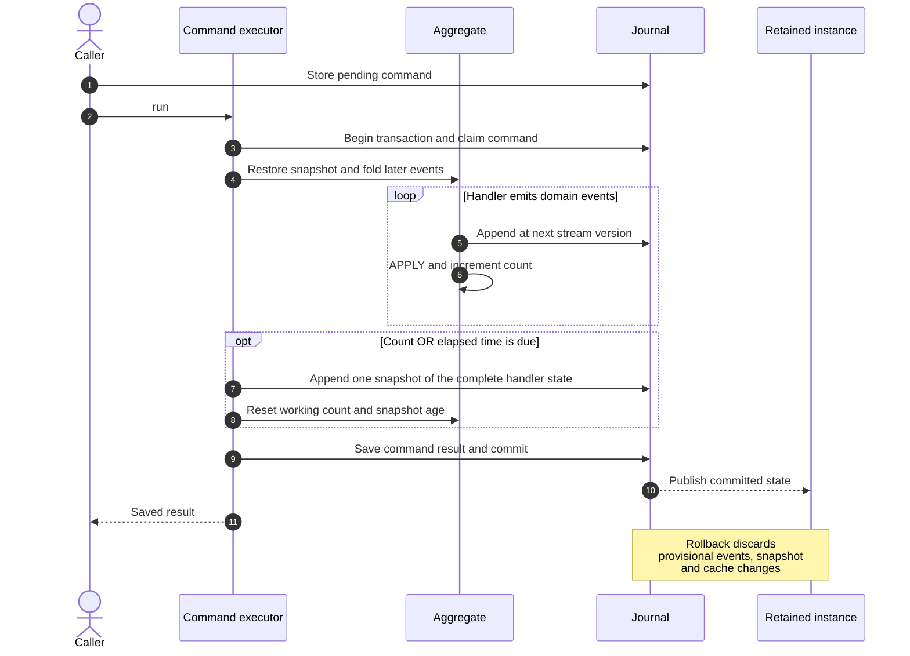
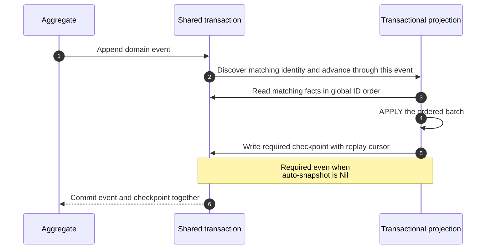

# Automatic snapshots

Aggregates, projections and sagas automatically checkpoint after **100 applied
records** by default. Retention and checkpoint frequency are independent: an
`OnDemand` entity can checkpoint automatically, and a retained entity can disable
optional snapshots. A load can evict another `Cached` entity and checkpoint that
entity's dirty state; it never runs a saga effect.

## Declare a policy

```raku
aggregate Account[:retained, :auto-snapshot{ :100count, :300seconds }] { ... }
projection Balance[:!retained, :auto-snapshot{ :500count }] { ... }
saga PurchaseWorkflow[:retained, :!auto-snapshot] { ... }
```

`:retained` selects `Retained`; `:!retained` selects `OnDemand`. Omission keeps
`Cached`. An omitted snapshot policy inherits the global policy.
`:!auto-snapshot` (equivalently `:auto-snapshot(False)` or
`:auto-snapshot(Nil)`) disables optional snapshots. Named options can be set
before first use with `.^lifecycle(:retained, :auto-snapshot{ :100count })`.
See [entity lifecycle](lifecycle.md) for the supported lifecycle aliases.
`.^lifecycle` and `.^auto-snapshot` report the effective choices; `:declared`
reports declaration defaults. Policies returned by the metaclass are immutable
maps, or undefined when disabled.

`count` must be a positive integer. `seconds` must be a positive finite number.
Provide either or both; unknown keys and empty policies fail at configuration
time. The thresholds use **OR**. A policy containing only `seconds` does not
inherit the default count limit. Declaration values are evaluated at compile time,
so constant expressions such as `:seconds(5 * 60)` are supported.

## Configure the global default or a class

```raku
use RedSourcing::Config;
config {
    .driver = 'SQLite';
    .database = 'events.db';
    .auto-snapshot = { :100count, :300seconds };
    .entities = {
        'App::Account' => { retained => True, auto-snapshot => { :200count } },
        'App::Balance' => { retained => False },
        'App::PurchaseWorkflow' => { auto-snapshot => False },
    };
}
```

Resolution is **per-class file override → explicit declaration → global file
policy → built-in `count => 100`**. Each policy replaces the previous policy
entirely. A lifecycle override leaves the snapshot policy untouched, and vice
versa. `.auto-snapshot = False` or `Nil` disables the global policy, while explicitly enabled
declarations still take precedence. File overrides match exact full type names.
`retained` must be a Bool; do not specify both `retained` and `lifecycle` in one
entry.

Native `red-sourcing-defaults`, the CLI and the monitor's operation subprocesses
apply the same settings. Policies are connection/pool-scoped and frozen for each
type at its first create, load or operation. Reapplying identical effective choices
is allowed. Configure before use; restart the application to change an active
type's policy. Importing the library does not read configuration or open a store.

## What is counted and when it is saved

When a `Cached` entity leaves the cache through capacity eviction or explicit
release, enabled automatic snapshots also checkpoint any changes since its last
snapshot, regardless of the count/time thresholds. Clean entities are skipped.
This applies to aggregates, projections and sagas. Use `:!auto-snapshot` or a
per-class/global disabled policy to opt out. Snapshots wait for active operations
and caller commit; rollback discards deferred snapshots. Failures are recorded in
store diagnostics and leave journal replay available.

| Entity | Count | Automatic checkpoint boundary |
| --- | --- | --- |
| Aggregate | Domain events applied from its own stream, excluding snapshots | Successful command completion, including other aggregates touched by the command |
| Projection | Matching domain events actually applied, excluding snapshots and saga controls | Explicit `.^advance` |
| Saga | Controls committed or passively restored from its own stream | Each durable control transition |

Saga controls contain the state resulting from source consumption, action claims,
results, retries and timeouts. Counting those controls measures its restoration
work; reading a source fact is not counted again as a separate restoration step.
Global row IDs and other streams' versions are not event counters.

`seconds` measures wall-clock time since the latest stored snapshot. Without a
snapshot, it starts at the first consumed record's stored creation time. The
policy is checked during operations and requires a nonzero applied count. Idle
entities do not produce repeated snapshots. There is no background timer; a
controller must perform an operation to evaluate a time limit.

Manual snapshots reset the same count and age. Restoring an entity initializes
them from the snapshot and replays later applicable records. Snapshot metadata is
runtime state derived from the journal, not extra domain payload or schema
columns. An automatic aggregate snapshot consumes the next stream version, just
like a manual snapshot; domain versions therefore need not be contiguous.



Automatic snapshots use the operation's existing transaction. An aggregate
snapshot optimistic conflict participates in the command's rollback/retry
protocol. Caller-owned transactions publish retained state only after the outer
commit. A saga's claims and results keep their separate durability boundaries;
checkpointing does not execute a service again or turn a whole advance into one
transaction.

`False` and `Nil` do not remove required safety checkpoints: aggregate creation still
writes its initial snapshot, and `is transactional` projections still checkpoint
ordered replay inside the emitting transaction. That required checkpoint resets
the optional policy too, so the same advance does not write a second snapshot.
`.^emit-snapshot` remains available with every policy.



See [entity lifecycle](lifecycle.md), [projection routing](projections.md) and
[saga recovery](sagas.md). Tests in `t/50-auto-snapshot.rakutest` and
`t/51-auto-snapshot-config.rakutest` cover thresholds, restoration, rollback,
snapshot conflicts, required checkpoints, lost acknowledgements and configuration.
