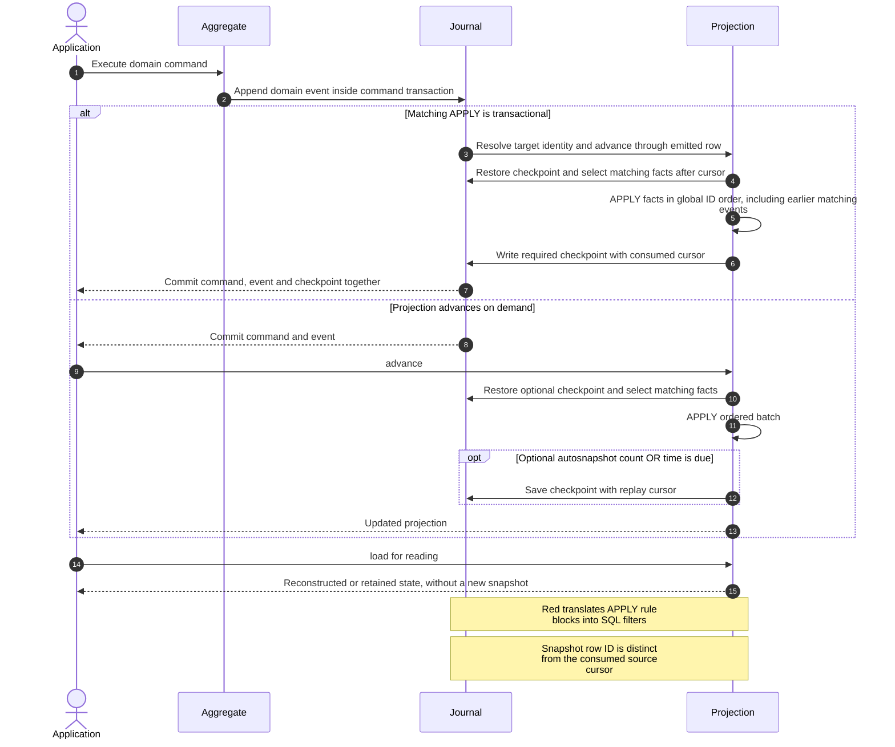

# Projections and transactional updates

## Sequence: ordered replay and the two update paths



Projections consume domain events and build read models. They cannot declare
commands or emit domain events. Use aggregate commands to change domain state.

By default, each `$proxy.^load` restores the latest projection checkpoint and
replays matching events. `.^advance` also catches up an existing instance or a
proxy. It does not save a checkpoint unless you pass `:checkpoint`; use
`.^emit-snapshot` to explicitly save one even when no newer event was consumed.

## Advance inside an aggregate command's transaction

Annotate an `APPLY` candidate with `is transactional`:

```raku
use RedSourcing;
red-sourcing-defaults(:driver<SQLite>, :database(':memory:'));

class Credited does Event {
    has Str $.account-id;
    has Int $.amount;
}

aggregate Account {
    has Str $.account-id is entity-id;
    has Int $.amount = 0;
    method APPLY(Credited $event) { $!amount += $event.amount }
    method credit(Int :$amount!) is command {
        self.credited(:$amount);
        $!amount
    }
}

projection Balance {
    has Str $.id is entity-id;
    has Int $.amount = 0;
    method APPLY(Credited $event where { .account-id eq $!id })
        is transactional {
        $!amount += $event.amount;
    }
}

my $account = Account.^with-ids(:account-id<a1>);
$account.^create;
$account.credit(:amount(5));
# Balance: id = a1 already has a committed checkpoint with amount 5.
say Balance.^with-ids(:id<a1>).^load.amount;
```

The event triggers an ordered advance of the **whole projection** through that
event's journal ID. Earlier pending events handled by unannotated candidates are
also consumed. It does not invoke only the annotated candidate out of order.
Several matching candidates or routing branches advance one identity once.

The projection state and consumed cursor are checkpointed in the same transaction
as the event. If an `APPLY` fails, the command's events and all intermediate
checkpoints roll back together. The command's technical optimistic-lock retries
reconstruct state before trying again. A handler's business exception remains a
command failure.

The process executing commands must import the modules declaring its transactional
projections. Package-scoped types are discovered from loaded modules, including
precompiled modules. A lexical `my projection` in a precompiled module must call
`MyView.^subscribe` during application initialization if no proxy is constructed
before events arrive. Constructing a proxy also registers its type. The database
does not contain executable `APPLY` definitions.

## Infer IDs from the signature

The default `OnDemand` lifecycle infers target IDs from positive equalities in the
annotated signature. No separate mapping is required:

```raku
.account-id eq $!id                           # Different field names
$!id eq .account-id                           # Reversed operands
.client-id eq $!client-id && .month eq $!month # Composite identity
.to-client eq $!id || .from-client eq $!id     # More than one target
(.account-id ~ '-copy') eq $!id                # Computed event-side value
```

Every satisfiable routing branch must determine all `entity-id` attributes. The
implementation checks conflicting assignments, validates ID types, checks the
remaining predicates and deduplicates the resulting streams. A projection without
IDs has a single target. Rule blocks are translated into SQL filters; they are
not callbacks executed for every stored event.

The implementation does not solve arbitrary inverse expressions such as
`.amount > $!minimum` or `.account-id eq ($!id ~ '-copy')`. On-demand discovery also
rejects dependencies on mutable non-ID receiver state and native attributes such
as `int`; object-backed `Int` and `Str` IDs are supported. Unsupported discovery
raises an error and rolls back the emission rather than silently missing targets.
Conditions must be pure and SQL-translatable. Ordinary `&&` and `||` are supported;
do not replace them with Red's SQL-only `AND`/`OR` in signatures that must also
match concrete in-memory events.

## Keep instances in memory

Lifecycle is shared with aggregates and sagas. See [entity lifecycle](lifecycle.md)
for `EntityLifecycle`, per-type configuration overrides and shared cache boundaries.

Choose lifecycle in the projection declaration. Omitting brackets is equivalent
to `[:!retained]`; `[:retained]` keeps instances loaded on the connection/pool:

```raku
projection Balance[:retained] {
    has Str $.id is entity-id;
    has Int $.amount = 0;
    method APPLY(Credited $event where { .account-id eq $!id })
        is transactional {
        $!amount += $event.amount;
    }
}
```

Replace the earlier `Balance` declaration with this one. Load the identity before
submitting credits so the retained instance participates in updates:

```raku
my $proxy = Balance.^with-ids(:id<a1>);
my $view = $proxy.^load;
# Repeated load returns this registered instance on the same connection/pool.
$account.credit(:amount(2));
say $view.amount; # 7, after the command's transaction commits
$proxy.^advance; # Catch up facts written by another process
$proxy.^release; # Stop retaining this identity
```

The metaclass's `.^lifecycle(:retained)` remains available for
programmatic configuration before first use. The declaration
calls this same configuration path during compilation.

Retained target discovery scans registered instances of the subscribed type and
checks the original signature with each instance as `self` and the emitted event
as its argument. It does not execute the handler body. This supports predicates
that cannot uniquely infer IDs, including inequalities. It does not create unseen
identities. Register the instances you want to maintain by loading their proxies.

Every transaction uses detached working state. Shared instances receive the new
state only after the outer transaction commits, including caller-owned `red-do`
transactions. Rollback discards provisional scalar, array and hash changes. A
released instance receives no further updates; a later load creates a new one.

The cache is process-local and scoped to the Red connection or PostgreSQL pool.
Keep its schema/search-path configuration fixed. Another process's writes do not
push updates into this cache: call `.^advance` to catch up and refresh a newer
checkpoint. Applications sharing retained objects across threads must serialize
their reads and calls. Constraints should normally use IDs and immutable settings;
current-state conditions are evaluated before the triggered replay, using the
transaction's starting state.

## Ordering across streams

Transactional replay is supported on SQLite and PostgreSQL. SQLite serializes
journal writes through its database write lock. PostgreSQL framework writers
acquire a transaction-scoped advisory gate for the event table before allocating
journal IDs and keep it until commit. Domain events, snapshots and saga controls
participate. The append phase is serialized within the store; command computation
can still run concurrently before its first append.

This prevents a later writer from checkpointing past an earlier uncommitted event
from another stream. The unique `(stream, version)` optimistic lock remains in
place and handles aggregate version contention. Raw SQL or direct ORM inserts
that bypass framework journal writers do not participate in this ordering
protocol. Other database drivers require a corresponding gate implementation.
