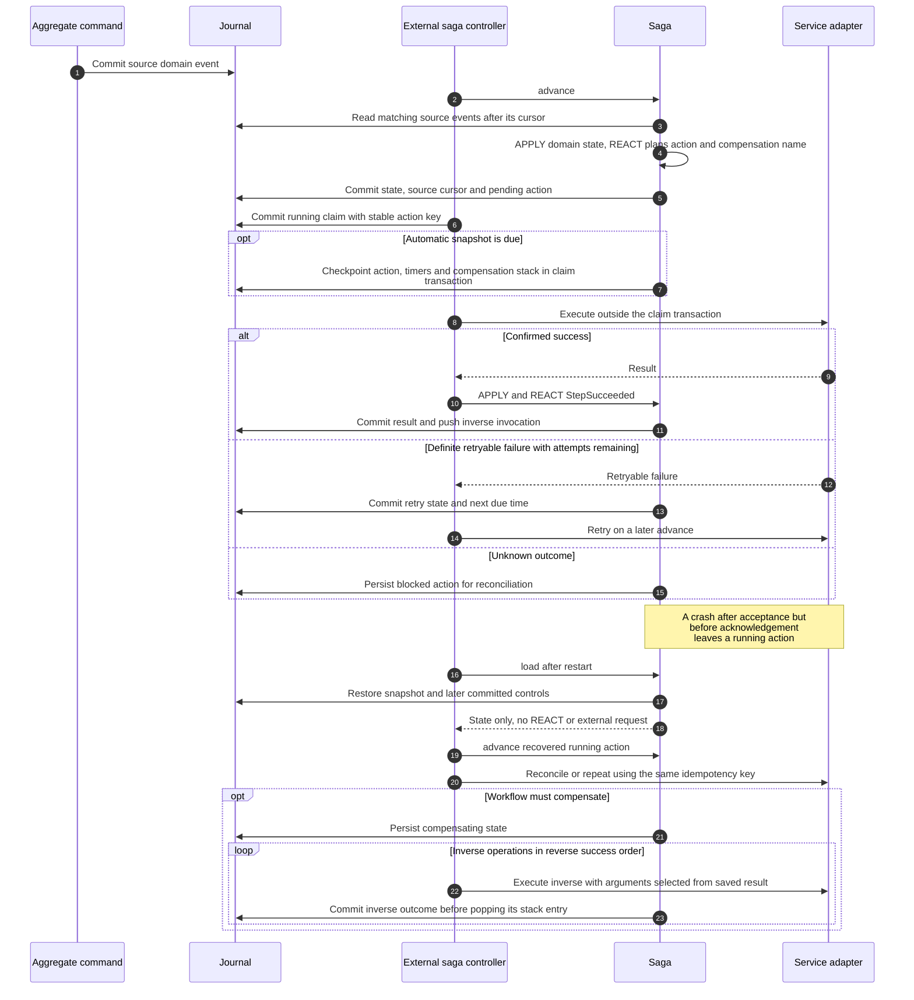

# Sagas

## Sequence: durable intent, external effect and recovery



Child aggregate commands use a persisted command row and reuse its completed
result on recovery. External providers need idempotency/reconciliation across the
acceptance/acknowledgement boundary. See [automatic snapshots](auto-snapshot.md)
and [the order example](../examples/order-saga/README.md).

A `saga` consumes domain events across streams and coordinates aggregate commands
and external services. Its own stream stores control events, domain state,
source cursor, action descriptors, compensation invocations and named deadlines.
Snapshots include the same state. `use RedSourcing` exports the declaration,
`StepSucceeded`, `StepFailed`, `StepUncertain`, `CompensationSucceeded`,
`Exponential`, `Permanent`, `Retryable`, `Uncertain` and `register-service`.

Run the [complete order saga example](../examples/order-saga/main.raku):

```sh
raku -Ilib examples/order-saga/main.raku
raku -Ilib t/13-sagas.rakutest
```

The example reserves stock, charges a simulated payment service, checkpoints,
then expires its delivery deadline. It refunds the payment before releasing stock.
The adapter is an in-memory demonstration, not an HTTP payment integration.

## State and reactions

Use `APPLY` to update public, persistible attributes and `REACT` to schedule
operations. Both methods support multi candidates and SQL-translatable event
constraints, including comparisons with the saga's identity. Their signatures
select the source events. An empty saga still needs an `APPLY` method, like other
entities; it can handle a specific type without changing state.

```raku
saga OrderSaga {
    has Str $.order-id is entity-id;
    has Rat() $.amount = 0.0;

    method APPLY(OrderSubmitted $event where { .order-id eq $!order-id }) {
        $!amount = $event.amount;
    }
    method REACT(OrderSubmitted $event where { .order-id eq $!order-id }) {
        self.set-timeout: 'delivery-deadline', 15 * 60,
            expire => \(reason => 'Delivery deadline exceeded');
        self.reserve-stock;
    }
    method reserve-stock {
        Inventory.^with-ids(:$.order-id).reserve: :service-retry{:3max,:2delay}
    }
    method compensate-reserve-stock(Str :$reservation-id!, |) {
        Inventory.^with-ids(:$.order-id).release:
            :$reservation-id,
            :service-retry{:5max,:10delay}
    }
    method expire(Str :$reason!) is command { self.^compensate: :$reason }
}
```

`APPLY` runs before `REACT`. Both also retain their scopes when called directly. RedSourcing rejects command submission, command
execution and event emission from `APPLY`, including calls through another
aggregate's proxy. Saga effect helpers and timeout helpers also reject that scope.
These checks apply to library APIs; arbitrary HTTP or other external calls made
outside those APIs cannot be intercepted.

A reaction runs on an isolated JSON copy. Its effects are buffered as descriptors.
Before writing the control event, the runtime compares the persisted domain state
before and after the reaction. Scalar and nested collection changes cause an
exception; the copy and intents are discarded and the source cursor stays put.
This checks the net change at the end of the reaction. It does not trap every write
instruction, including a write followed by restoration of the original value.
Direct aggregate proxy calls in `REACT` are routed to the current saga
and buffered until validation finishes. They return a durable action ID, not
the business result of the command. Public attributes must be JSON-compatible,
as they already must be for snapshots. Private domain fields are not persisted.

`.^load` restores committed controls and checkpoints without running `REACT`,
commands or services. New source events are consumed by `.^advance`, rather than
by loading the saga. Ordinary projections ignore saga control events.

## Commands and services

Call the named saga method normally. It records an operation and returns its
stable action ID; it does not execute the operation immediately. No `start-step`
API is needed. `.^advance` executes eligible operations in order.

```raku
my $saga = OrderSaga.^with-ids(:order-id<order-1>).^load;
my $action-id = $saga.reserve-stock;
$saga.^advance;
```

Command proxies accept `:service-retry{...}` and `:service-compensation` during
saga planning. These become `:retry` and `:compensation` options on the saga action;
they are removed before command arguments are validated or persisted. For example,
`:!service-compensation` disables automatic compensation, while
`:service-compensation<undo-reservation>` selects a named saga method. Omitting
these options preserves the normal retry and compensation defaults.

The `service-` prefix is reserved. Unknown options and use outside saga planning
raise errors, including in a long-lived `is service` method. Such services still
route normal proxy commands through their fenced `ServiceContext`. `:!sync` is
not supported during saga planning: the action is always scheduled for the
controller. Commands remain forbidden in `APPLY` and `is query` bodies.

Build the target proxy with `Target.^with-ids(...)`, or use `Target.^from(self)`
to infer its entity IDs from public attributes of the saga. A required target ID
need not itself be an ID of the saga; missing attributes raise an error. For example:

```raku
Inventory.^from(self).reserve: :service-retry{:3max, :2delay};
```

Aggregate commands accept named arguments. The same preparation as a normal
proxy call validates constraints, normalizes aliases and evaluates defaults
before persisting the action. Retries reuse those values rather than evaluating
defaults again.

`.^service('adapter-name', 'operation', Capture, ...)` accepts both positional and
named arguments. Register the adapter in each process that runs the controller:

```raku
register-service('payments', -> Str $operation, Capture $arguments,
                               Str :$idempotency-key! {
    # Send the key to a provider with durable idempotency support.
    # Return a JSON-compatible result, for example:
    %(payment-id => 'payment-1', receipt => 'receipt-1')
});
```

The adapter receives the same key on every retry or crash recovery of that logical
operation. Forward effects and compensations have separate keys. The registry
contains code; only its logical name, method and arguments are persisted.

## Compensation

By default, a named saga method `reserve-stock` uses `compensate-reserve-stock`
when that method exists. Discovery uses the originating saga method, not the
target aggregate command or service operation. Override it with
`:compensation<another-method>`, or disable it with `:!compensation`.

A successful effect must return a `Hash` or `Map` if it has a compensation. The
runtime checks that `|%result` binds to the compensator's original signature
without invoking its body. It then saves the method name, an immutable JSON copy
of the result, action ID and original domain context. Target identity inference
during compensation uses that saved context, so later state changes cannot
redirect the inverse operation. Invalid binding blocks the action and retains
the successful result for repair; it does not execute the compensator.

Request compensation with `self.^compensate(:reason<failure>)`, usually from a
`REACT(StepFailed $event)` or a timeout method. Only then are compensator bodies
called, in reverse order, with `|%result`. Named parameters select required return
fields; a trailing `|` accepts extras. These methods can also be called directly
with ordinary named arguments.

A compensator schedules exactly one command or service operation. Its stack
entry is removed only after that operation succeeds. Its own retry policy applies,
and retries reuse the saved inverse descriptor without invoking the compensator
body again. Compensators do not register compensations recursively. Requesting
compensation again while already compensating is harmless. Pending forward work
is cancelled; an already running or uncertain operation must be settled first.
An uncertain scheduled retry becomes blocked when compensation is requested.
Late forward success during compensation registers its inverse without starting
further forward steps.

`.^complete` ends a successful workflow, cancels timers and discards the undo
stack. It refuses unresolved work. Completion and compensation are explicit
business decisions; `StepFailed` reports a terminal operation failure to the
saga's live reaction. A saga without a failure reaction does not automatically undo
its earlier operations.

## Retry and uncertain outcomes

Command business retries use separate stored records. Optimistic lock conflicts
are internal transaction retries on the **same** command record: the handler is
re-run against freshly loaded committed state, with up to five immediate attempts.
Persistent contention leaves that record `Pending` and the saga action `running`;
the next advance resumes the same child without increasing the action's business
attempt count, emitting `StepFailed`, or starting compensation.

Success is `Done`; other failures roll back events, save `Failed` and the error,
and rethrow. Calling `.run` on a failed record reports the saved error without
invoking the handler again. A business retry
submits a new command record. The initial `next-run` schedule and `.run(:wait)`
remain available; command retries are scheduled by sagas.

Saga policies accept `max` or `max-attempts` (including the initial attempt),
`delay`, `backoff(Exponential)`, `init-delay` and `max-delay`. The delay after failed
attempt N is `min(init-delay * 2 ** (N - 1), max-delay)` for exponential policies.
Without a policy, there is one attempt. Retry times are persisted absolute
instants. The controller never sleeps waiting for a retry.

Adapters should throw `Permanent` for a definite rejection that should not be
retried, `Retryable` for a definite failure without an effect, and `Uncertain`
when the outcome is unknown. An unclassified service exception is also treated as
uncertain once retries are exhausted. Retrying uncertain operations requires the
provider to honor the stable idempotency key. Exhausted uncertain actions emit
`StepUncertain` and remain blocked, rather than triggering compensation of a
possibly incomplete workflow.

After checking the provider, reconcile explicitly:

```raku
$saga.^resolve-action: $action-id, :result{payment-id => 'confirmed-payment'};
# Or, only after confirming that no effect occurred:
$saga.^resolve-action: $action-id, :error('Payment was rejected');
$saga.^advance;
```

The result follows the same success and compensation-binding rules. A confirmed
failure emits `StepFailed`. A blocked action pauses subsequent work. A failed
compensation retains its stack entry and failure history; automatic retries stop
at its limit. An operator API for retrying a repaired, exhausted compensation is
a follow-up item.

## Timeouts and the controller

```raku
self.set-timeout:
    'delivery-deadline', 15 * 60,
    expire => \(reason => 'Delivery deadline exceeded');
self.cancel-timeout: 'delivery-deadline';
```

The third argument is exactly one named entry whose value is a `Capture`. The
target is a method of the same saga. Scheduling stores an absolute instant and
normalized arguments; the named entry replaces any previous timer of that name.
It does not call the target. Snapshots preserve timers. A due timer runs its
method in the same buffered reaction scope and records `TimeoutTriggered` with
the resulting intents. A failed timer handler leaves the timer pending for repair.

An external controller periodically calls `$proxy.^advance`, or its alias
`$proxy.^check-timeouts`. Both consume source facts, check timers and run ready
work. Committed source facts are observed before deciding whether to fire timers.
`:limit(100)` bounds operation processing per call; `:now(DateTime)` allows a
controlled clock for tests. Within handlers, `self.^now` returns that same clock
(or the current time outside an advance). This lets an event consumer compute
the remaining interval from `Event.emitted-at`, preserving the original deadline
when a controller catches up late. These methods do not start background threads.
See the [shopping cart reminder](../examples/shopping-cart/README.md#abandoned-cart-reminder-saga)
for activity-based replacement, cancellation, retries and a durable simulated
email provider.

### Advance every active instance

`use RedSourcing` exports a one-call controller pass:

```raku
my %tick = advance-sagas(:now(DateTime.now), :limit(100));
say "Advanced {%tick<advanced>}; failed {%tick<failed>}";
say "{.<stream>}: {.<status>}" for %tick<sagas>.List;
```

The function discovers persisted saga instances on the current connection from
their latest snapshots/controls. It advances those in `running` or `compensating`,
including sagas waiting for source events, retries or timers. Completed and
compensated instances are skipped. No proxy registration is needed; saga modules
must be loaded or available on the process's Raku include paths, and service
adapters must be registered in that process.

Every instance receives the same `:now`. `:limit` bounds actions **per saga**;
`:limit(0)` still consumes source events and checks due timers. The result contains
`advanced` (successful advance calls), `failed` and a `sagas` array with `stream`,
`type`, final `status` and an `error` message for each failed instance. One instance
failure does not prevent other instances from progressing. Store/discovery errors
still throw. A successful call can be a no-op for a saga awaiting input.

One call makes one pass, without starting a background thread or sleeping. Call
it periodically from your controller. A fact emitted for an already visited saga,
or a saga created during the pass, can require the next pass. This helper retains
the existing per-saga transaction, recovery and concurrency behavior; it does
not introduce a shared transaction or multi-controller leases.

Own control versions and the consumed global source cursor are separate. A child
command is submitted atomically with the saga's running claim. If the process
stops after the child commits but before the saga acknowledges success, recovery
reads the same command's saved result. Service recovery calls the adapter again
with the same operation key. Control writes use optimistic stream versions.

Inspect committed work with `red-sourcing saga-status SAGA --id=FIELD=VALUE`
or database-only `red-sourcing saga-status --stream=NAME`. The report shows
the next action, retry delays, failures, timeouts, domain values and saved
compensations without replaying handlers or running effects. An empty queue
can mean waiting for an event; only explicit `.^complete` marks successful
completion. See [the CLI diagnosis guide](cli.md#saga-diagnosis).
Native control events also inherit `Event.emitted-at`, the journal's recorded
emission `DateTime`, preserved during restoration.

The runtime stores full state in control events for straightforward,
pure recovery. Compact delta events, bounded source batches, leases for multiple
controllers, PostgreSQL/multi-connection tests, command failure ownership and
schema migrations are still needed before claiming production concurrency
guarantees. External HTTP effects require durable provider idempotency; a database
transaction cannot make them exactly once. Persisted method/type/adapter names
must remain resolvable when deploying new application versions.

## Cooperating workflows and current constraints

Sagas change application domain state by requesting aggregate commands. They
do not own domain events; the runtime writes their native control events and
checkpoints. Projections are read models and cannot declare commands or emit
domain events. Standalone source emissions and simulated provider receipts in
small demos are fixtures; represent real incoming provider updates with commands
on an aggregate rather than calling `Event.emit` from application code.

The [commerce example](../examples/commerce/README.md) uses eight sagas connected
by domain events. It separates reversible purchase/booking work from physical
shipping, stock returns and refunds. The shopping-cart example uses a smaller
activity-based email reminder. Both persist simulated provider receipts.

Use named methods for effects. Calling an effect directly inside `REACT` names
the action `REACT`, which loses a useful step identity and affects compensation
method discovery. An explicit `:step` API is not provided.

Actions are processed in insertion order; a future/blocked head action can prevent
later independent work from running. There is no child-saga/join API or terminal
application callback for completed compensation. Commerce's controller routes
new input, tracks due work and bridges fully compensated state to idempotent domain
commands. See [API feedback](../examples/commerce/README.md#saga-api-feedback) and
the [roadmap](next-steps.md) for these limits and proposed improvements.
