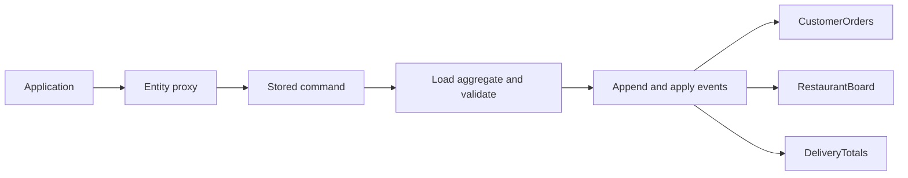
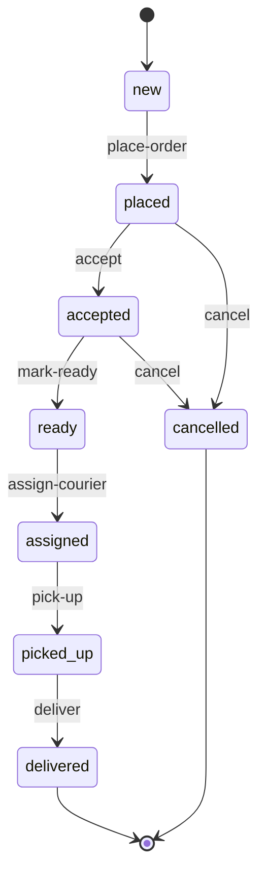

# Build a food delivery system with RedSourcing

This tutorial builds the backend of a small food delivery service. A restaurant
publishes its menu, a customer places an order, the kitchen accepts and prepares
it, and an assigned courier picks it up and delivers it. Customers can follow
their orders, restaurants can see their active work, and the service can report
delivered order value across all restaurants.

The [complete example](../../examples/food-delivery/README.md) accompanies this
tutorial. It uses the current RedSourcing API, an in-memory SQLite database and
exact `Rat` amounts. All commands, events and projections run in one process;
the stored command API also lets us defer execution.

## 1. Run the finished application

From the repository root, install the distribution's dependencies and run the
example:

```sh
zef install --deps-only .
raku -Ilib -Iexamples/food-delivery examples/food-delivery/main.raku
```

You need Raku and a working SQLite driver for Red. The example creates its tables
in a fresh in-memory database on each run. It ends with:

```text
Deferred delivery: Pending
Delivery result: delivered
Repeated command: delivered
Tracking after checkpoint: delivered
Restaurant board: 0 active orders
Totals: 2 placed, 1 delivered, 1 cancelled, delivered value 30.75
```

Keep the files in `examples/food-delivery` available through `-I` while following
the steps below. The code blocks that submit commands belong in the application
script; the aggregate and projection definitions belong in their modules.

## 2. Choose the aggregate boundaries

An aggregate owns the rules for one entity and appends events to that entity's
stream. A projection builds a view from events, potentially from many streams.
We will use two aggregate types and three projection types:

| Type | Kind | Identity | Responsibility |
| --- | --- | --- | --- |
| `Restaurant` | Aggregate | `restaurant-id` | Menu prices, item availability and accepting new orders |
| `DeliveryOrder` | Aggregate | `order-id` | Receipt, preparation, courier assignment, delivery and cancellation |
| `CustomerOrders` | Projection | `customer-id` | Tracking and receipts for one customer |
| `RestaurantBoard` | Projection | `restaurant-id` | Active orders for one kitchen |
| `DeliveryTotals` | Projection | No IDs | Counts and delivered value across all order streams |

Menu changes belong to a restaurant stream. Order transitions belong to an order
stream. Preparing one order therefore does not append to the restaurant's stream
or modify another order's version.



The arrows into projections represent reads during replay. There is no background
projection worker in this example: loading a projection folds its matching events.

## 3. Define facts as events

Create [DeliveryEvents.rakumod](../../examples/food-delivery/DeliveryEvents.rakumod).
Domain event classes do the `Event` role. Their public attributes become the
persisted JSON payload.

For example, a menu update records the complete new menu entry:

```raku
use RedSourcing;
unit module DeliveryEvents;

class MenuItemSet is export does Event {
    has Str $.restaurant-id is required;
    has Str $.item-id is required;
    has Str $.name is required;
    has Rat() $.unit-price is required;
    has Bool $.available is required;
}
```

Order events share identity fields. This lets a projection select events for a
customer or restaurant without joining to an earlier placement event:

```raku
role ForDeliveryOrder is export {
    has Str $.order-id is required;
    has Str $.restaurant-id is required;
    has Str $.customer-id is required;
}

class OrderPlaced is export does Event does ForDeliveryOrder {
    has Str $.address is required;
    has Array $.items is required;
    has Rat() $.subtotal is required;
    has Rat() $.delivery-fee is required;
    has Rat() $.total is required;
    method status { 'placed' }
}

class OrderDelivered is export does Event does ForDeliveryOrder {
    has Str $.courier-id is required;
    has Rat() $.total is required;
    method status { 'delivered' }
}
```

The complete module also defines `RestaurantOpened`, `RestaurantClosed`,
`OrderAccepted`, `OrderReady`, `CourierAssigned`, `OrderPickedUp` and
`OrderCancelled`. Order events expose their resulting status through a method.
That status is derived from the event type; it is not a caller-supplied field.

`OrderPlaced.items` is an `Array` of hashes containing item ID, name, unit price
and quantity. The scalar `Array` attribute preserves this shape when stored JSON
is passed to `bless` during event and snapshot reconstruction. `Rat()` attributes
coerce reconstructed amounts back into rational values.

The placement event freezes the agreed receipt. A future menu price change must
not change an order that was already placed. `OrderDelivered` repeats the agreed
total so the totals projection can add it directly without looking up a receipt.

## 4. Build the restaurant aggregate

[Restaurant.rakumod](../../examples/food-delivery/Restaurant.rakumod) declares an
aggregate with a typed identity and an initially closed menu:

```raku
use RedSourcing;
use DeliveryEvents;

unit aggregate Restaurant;

has Str $.restaurant-id is entity-id;
has Str $.name is required;
has Bool $.open = False;
has %.menu;

multi method APPLY(MenuItemSet $event) {
    %!menu{$event.item-id} = %(
        item-id => $event.item-id, name => $event.name,
        unit-price => $event.unit-price, available => $event.available,
    );
}

method set-menu-item(
    Str :$item-id! where *.chars > 0,
    Str :$name! where *.chars > 0,
    Rat() :$unit-price! where { $_ > 0 && ($_ * 100).denominator == 1 },
    Bool :$available = True,
) is command {
    self.menu-item-set: :$item-id, :$name, :$unit-price, :$available;
    %!menu{$item-id}
}
```

The module also applies the open/closed events and defines `open-for-orders` and
`close-for-orders`. Opening requires at least one available menu item.

Two pieces of generated behavior make this API work:

1. `is command` turns a call on the entity's proxy into a stored command. The
   declared method body becomes the handler that runs on the loaded aggregate.
2. The concrete `APPLY(MenuItemSet $event)` candidate generates `menu-item-set`
   on the aggregate. It constructs the event, fills `restaurant-id` from the
   aggregate's identity, appends it at the next stream version, applies it and
   advances the aggregate's metadata.

You do not need a separate command class or a handwritten event emitter. Do not
mutate the menu in the command body and emit a second copy of the change: the
generated event method already calls `APPLY` before returning.

The price constraint accepts positive amounts with at most two decimal places.
Keeping amounts in whole cents makes this example's decimal JSON round trips
preserve the exact values used for money calculations.

## 5. Initialize the store and publish a menu

At the top of [main.raku](../../examples/food-delivery/main.raku), import the
library and domain modules:

```raku
use RedSourcing;
use Restaurant;
use DeliveryOrder;
use CustomerOrders;
use RestaurantBoard;
use DeliveryTotals;

red-defaults 'SQLite', :database(':memory:');
schema(StoredEvent, StoredCommand).create;
```

`use RedSourcing` supplies both storage models, the entity declarations, traits,
roles and Red's database configuration. `StoredEvent` and `StoredCommand` are the
short names for `RedSourcing::StoredEvent` and `RedSourcing::StoredCommand`.

Create a proxy with `.^with-ids`, then publish its first snapshot:

```raku
my $restaurant = Restaurant.^with-ids: :restaurant-id<green-kitchen>;
$restaurant.^create: :name('Green Kitchen');
$restaurant.set-menu-item: :item-id<bowl>, :name('Rice bowl'), :unit-price(12.50);
$restaurant.set-menu-item: :item-id<juice>, :name('Orange juice'), :unit-price(3.25);
$restaurant.open-for-orders;
```

An aggregate needs an initial snapshot before its commands can load it. Here
that snapshot represents a closed restaurant with an empty menu. Menu and opening
events follow it. Use `.^create` once for a new identity; an existing identity
should be accessed through its proxy and `.^load`.

The proxy is an identity handle. `$restaurant.^load` reconstructs the actual
aggregate from its latest snapshot and subsequent events. Infrastructure methods
use `.^`, leaving ordinary method names available to domain commands.

## 6. Validate and price an order

[DeliveryOrder.rakumod](../../examples/food-delivery/DeliveryOrder.rakumod) owns
the order lifecycle. Its identity is `order-id`; restaurant and customer IDs are
ordinary domain fields established during placement.

The placement command accepts item IDs and quantities. It resolves item names
and prices from the restaurant aggregate at execution time:

```raku
method place-order(
    Str :$restaurant-id! where *.chars > 0,
    Str :$customer-id! where *.chars > 0,
    Str :$address! where *.chars > 0,
    :%items! where *.elems > 0,
) is command {
    self!require-status: 'new';
    my $restaurant-proxy = Restaurant.^with-ids: :$restaurant-id;
    die "Restaurant '$restaurant-id' does not exist"
        unless StoredEvent.^all.grep({
            .class eq Restaurant.^name && .stream eq $restaurant-proxy.^stream-name
        }).head;
    my $restaurant = $restaurant-proxy.^load;
    die "Restaurant '$restaurant-id' is closed" unless $restaurant.open;

    # Resolve current names and prices on the server, before emitting any event.
    my @lines = %items.keys.sort.map: -> $item-id {
        my $quantity = %items{$item-id};
        die "Quantity for '$item-id' must be a positive integer"
            unless $quantity ~~ UInt && $quantity > 0;
        die "Item '$item-id' is not on the menu"
            unless $restaurant.menu{$item-id}:exists;
        my %item = $restaurant.menu{$item-id};
        die "Item '$item-id' is unavailable" unless %item<available>;
        %(item-id => $item-id, name => %item<name>,
            unit-price => %item<unit-price>.Rat, :$quantity)
    };
    my Rat $subtotal = [+] @lines.map: { .<unit-price> * .<quantity> };
    my Rat $delivery-fee = 2.50;
    my Rat $total = $subtotal + $delivery-fee;
    self.order-placed: :$restaurant-id, :$customer-id, :$address,
        :items(@lines), :$subtotal, :$delivery-fee, :$total;
    %(:$!order-id, :$!status, :$!subtotal, :$!delivery-fee, :$!total, :$!items)
}
```

The complete handler performs these checks before emitting `OrderPlaced`:

- The order is still `new`.
- The restaurant exists and is open for orders.
- Every item is on the menu and available.
- Every quantity is a positive integer.

It then calculates the subtotal, adds the example's fixed delivery fee of `2.50`
and calls the generated `order-placed` method. `APPLY(OrderPlaced)` stores the
receipt and changes the status to `placed`. The handler returns the updated receipt.

Create and place an order like this:

```raku
my $order = DeliveryOrder.^with-ids: :order-id<order-1001>;
$order.^create;
my %receipt = $order.place-order:
    :restaurant-id<green-kitchen>, :customer-id<ana>,
    :address('10 Market Street'), :items{ bowl => 2, juice => 1 },
;
say %receipt<subtotal>;     # 28.25
say %receipt<delivery-fee>; # 2.5
say %receipt<total>;        # 30.75
```

The initial snapshot represents a `new` order. The caller chooses its unique ID.
Placing the same order again is rejected. Later changes to the restaurant menu
do not modify this receipt.

Signature constraints, such as an empty address, fail before command persistence.
Checks that depend on current state, such as a closed restaurant or an unknown
menu item, run in the handler after the command has been stored.

## 7. Make the delivery lifecycle explicit

The order follows this state machine:



The persisted pickup status is the string `picked-up`. Cancellation is allowed
while placed or accepted; this example closes cancellation when preparation is
complete. Courier assignment happens after readiness.

Each handler checks its expected state before emitting the next fact. For example:

```raku
method !require-status(Str $expected) {
    die "Order '$!order-id' must be '$expected', but is '$!status'"
        unless $!status eq $expected;
}

method !event-ids { %(:$!restaurant-id, :$!customer-id) }

method accept is command {
    self!require-status: 'placed';
    self.order-accepted: |self!event-ids;
    $!status
}
```

The generated emitter fills `order-id`. The helper passes the restaurant and
customer IDs already established by placement. Those fields are not entity IDs
of `DeliveryOrder`, so they must be supplied explicitly on later events.

Continue the order through the kitchen and assign a courier:

```raku
$order.accept;                         # accepted
$order.mark-ready;                     # ready
$order.assign-courier: :courier-id<sam>; # assigned
```

`pick-up` and `deliver` check both the current state and the assigned courier ID.
Trying to deliver before pickup, use a different courier, or cancel after readiness
throws without appending a transition event.

These ID checks express domain rules. An application's authentication and
authorization layer must establish who may submit each command; the example
does not treat a supplied courier ID as proof of identity.

## 8. Build views with projection signatures

[CustomerOrders.rakumod](../../examples/food-delivery/CustomerOrders.rakumod)
selects all order events for one customer through its `APPLY` signature:

```raku
unit projection CustomerOrders;

has Str $.customer-id is entity-id;
has %.orders;

method APPLY(ForDeliveryOrder $event where { .customer-id eq $!customer-id }) {
    given $event {
        when OrderPlaced {
            %!orders{.order-id} = %(
                order-id => .order-id, restaurant-id => .restaurant-id,
                address => .address, items => .items.Array, total => .total,
                courier-id => '', cancellation-reason => '',
            );
        }
        when CourierAssigned { %!orders{.order-id}<courier-id> = .courier-id }
        when OrderCancelled { %!orders{.order-id}<cancellation-reason> = .reason }
    }
    %!orders{$event.order-id}<status> = $event.status;
}
```

The module imports `RedSourcing` and `DeliveryEvents` and defines the query
methods `tracking(:$order-id!)` and `orders-list`, both declared `is query`. The event role matches
every order lifecycle event, and the `where` constraint binds the selected
customer to the loaded projection. RedSourcing derives SQL selection rules from
that signature. The status method runs in the handler after event reconstruction.

Unlike an aggregate, this projection reads matching events from any order stream.
It does not require an initial snapshot: a customer with no history starts with
an empty view.

```raku
my $customer = CustomerOrders.^with-ids: :customer-id<ana>;
say $customer.tracking(:order-id<order-1001>)<status>; # assigned
say $customer.orders-list.elems;                    # 1
```

[RestaurantBoard.rakumod](../../examples/food-delivery/RestaurantBoard.rakumod)
uses the same role with `where { .restaurant-id eq $!restaurant-id }`. Its
`active-orders` query excludes delivered and cancelled orders:

```raku
my $board = RestaurantBoard.^with-ids: :restaurant-id<green-kitchen>;
say $board.active-orders.elems; # 1
```

[DeliveryTotals.rakumod](../../examples/food-delivery/DeliveryTotals.rakumod)
has no identity fields and consumes placement, delivery and cancellation events
from every order stream. It counts each outcome and adds the total only on
`OrderDelivered`. Its delivered value includes the delivery fee and does not
represent a payment settlement or restaurant profit.

Projection queries are methods declared `is query` and called on proxies, such as
`$customer.tracking(...)` or `DeliveryTotals.^with-ids.report`.
Projections cannot declare commands or own/emit domain events. Their `APPLY`
methods derive state from facts emitted by aggregate commands. The `where` blocks
in their signatures become SQL filters through Red: they are not called once
per stored event to filter an in-memory list.

## 9. Defer work and reuse its stored result

The default proxy call is synchronous. It stores a pending command, runs its
handler through the executor and returns the result to the caller.

Pass `:!sync` to store the command and receive its `StoredCommand` record instead:

```raku
$order.pick-up: :courier-id<sam>;
my $pending = $order.deliver: :courier-id<sam>, :!sync;
say $pending.state; # Pending
say $pending.run;   # delivered
say $pending.run;   # delivered, using the persisted result
```

Submission does not run the handler. `.run` loads the aggregate again and checks
its state at execution time. The event append, saved result and command completion
use the executor's transaction. Running the same completed record returns its
stored result and appends no second delivery event. Submitting a new `deliver`
command after delivery fails the state check.

The same rule applies to deferred order placement: menu names, prices and
availability are resolved when `.run` executes. A price shown earlier to a
customer is not automatically reserved. A service requiring a guaranteed quote
would need to model that quote explicitly.

Optimistic lock conflicts automatically roll back, reload committed state and
retry the same command, without a failed record or a saga business retry. After
five conflicting attempts in one pass, the command remains `Pending` for a later
executor pass; see the [command execution contract](../api.md#scheduling-and-attempts).

For other handler errors, the caller receives the exception and the command becomes
terminal `Failed` with its saved error. `.run` does not schedule another attempt
or invoke that failed handler again. Submit a new command to retry, or use a
[saga](../sagas.md) to coordinate retries and compensation. `next-run` and
`.run(:wait)` still support scheduling an initial attempt. This example invokes
`.run` directly and does not start a worker.

Saved-result reuse applies to the same stored command. It does not deduplicate
two submissions from an external caller or make a payment API idempotent.

## 10. Checkpoint and resume

To avoid replaying an entity's entire history on every load, publish a snapshot
of its current state:

```raku
$order.^load.^emit-snapshot;
$customer.^load.^emit-snapshot;
$board.^load.^emit-snapshot;
DeliveryTotals.^with-ids.^load.^emit-snapshot;
```

An aggregate snapshot contains the entity's public state, including its receipt
and courier. Loading the aggregate finds its latest snapshot and applies later
events from its own stream. Snapshot rows also occupy stream versions, so do not
assume that the next domain event's version equals the number of domain events.

A projection checkpoint stores the projection plus its consumed global event ID.
Loading it resumes selection after that cursor across source streams. It does
not use the checkpoint row's ID as its consumed cursor. Entity snapshots are
restoration records and are excluded from projection domain-event application.

The demo takes aggregate and customer checkpoints before pickup and delivery.
After delivery, customer tracking restores the checkpoint and consumes the
later events, reporting `delivered`. The regression tests also checkpoint the
restaurant board and global totals and verify repeated replay does not count
outcomes twice.

## 11. Cancel another order and inspect history

Create a second order, then cancel it before preparation completes:

```raku
my $other = DeliveryOrder.^with-ids: :order-id<order-1002>;
$other.^create;
$other.place-order: :restaurant-id<green-kitchen>, :customer-id<bob>,
    :address('20 Market Street'), :items{ bowl => 1 };
$other.cancel: :reason('Customer changed plans');

my %totals = DeliveryTotals.^with-ids.report;
say %totals<placed>;          # 2
say %totals<delivered>;       # 1
say %totals<cancelled>;       # 1
say %totals<active>;          # 0
say %totals<delivered-value>; # 30.75
```

Cancellation remains part of history. Its reason is available on the aggregate
and in the customer's view, and the restaurant's active board no longer includes
the order. No delivered value is counted for a cancelled order.

Inspect events and commands separately:

```raku
for StoredEvent.list-events(:row, :stream($order.^stream-name)) -> $row {
    say "{$row.version}: {$row.class}";
}
for $order.^list-commands -> $command {
    say "{$command.method}: {$command.state}";
}
```

`:row` returns storage records, including snapshots. Without it, `list-events`
reconstructs available domain classes. An event's `.StoredEvent` accessor gives
you its stored row when you need the ID, version or creation time.

## 12. Test the rules and extend the service

Run the example's regression suite:

```sh
raku -Ilib t/12-food-delivery-example.rakutest
```

It exercises menu updates and exact amounts, rejected orders, frozen receipts,
state transitions, courier checks, customer and restaurant selection,
cancellation, deferred placement against a changed menu, failed-command retry,
saved-result reuse, checkpoint restoration and the runnable demo itself.

The example implements the domain backend. To build an application around it,
add an authenticated API that maps requests to the existing proxy commands and
returns projection data. Keep network calls out of `APPLY`: replay should rebuild
state without sending notifications, charging a card or contacting a courier.

Useful next domain extensions are a courier aggregate for existence and capacity,
a restaurant acceptance/rejection policy, explicit payment and refund events,
and quote or inventory reservations. Courier IDs in this example are labels;
there is no courier registry or capacity reservation. The restaurant read during
placement is a current-state check, not an atomic lock on that restaurant's menu
or inventory. Independent concurrent database connections and PostgreSQL are not
validated by this example.

When adding external side effects, model their delivery and retry separately
from event replay. [Sagas](../sagas.md) coordinate retries, compensation and named
deadlines. Real payment adapters still need provider idempotency and outcome
reconciliation; see the [order saga example](../../examples/order-saga/README.md).


## 13. Share configuration with operational tools

The demo uses in-memory SQLite. A persistent service can use the same file as the
CLI and monitor:

```raku
use RedSourcing;
use Restaurant;
use DeliveryOrder;
my $settings = red-sourcing-defaults(:file<examples/food-delivery/red-sourcing.rakuconf>);
```

The imports above need `-Iexamples/food-delivery` at compile time. The runtime
configuration call returns include/module settings but does not compile those
imports for you. The CLI loads the file's modules when needed:

```sh
raku -Ilib bin/red-sourcing.raku -f=examples/food-delivery/red-sourcing.rakuconf init
raku -Ilib bin/red-sourcing.raku -f=examples/food-delivery/red-sourcing.rakuconf describe DeliveryOrder
raku -Ilib bin/red-sourcing.raku -f=examples/food-delivery/red-sourcing.rakuconf web-monitor
```

`init` creates tables rather than restaurants or orders; create and populate the
entities through application commands before placing a delivery. See the
[configuration guide](../configuration.md), [CLI guide](../cli.md) and
[commerce example](../../examples/commerce/README.md) for provider-oriented sagas.
