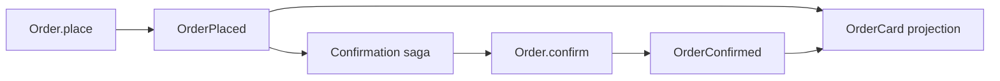

# Follow one order through the Raku REPL

This example has exactly one aggregate, one projection and one saga:

| Entity | Responsibility |
| --- | --- |
| `Order` aggregate | Validate `place` and `confirm`, then emit facts |
| `OrderCard` projection | Build a readable order status from those facts |
| `Confirmation` saga | React to `OrderPlaced`, schedule `Order.confirm` and finish on success |



Read the short [entity definitions](../../examples/simple-flow/lib/SimpleFlow.rakumod).
The aggregate's `APPLY` methods change its state. The generated `order-placed`
and `order-confirmed` methods emit events populated with its `order-id`.
The projection filters both event types by `order-id`. The saga's `REACT`
schedules a command; its `APPLY(StepSucceeded ...)` records success and its
`REACT(StepSucceeded ...)` completes the workflow. Native success controls belong
to that saga's own stream.

`self.^command(Order, 'confirm', \(), :!compensation)` gets the aggregate's
`order-id` from the saga. This small workflow has one attempt and no compensating
operation. There is no external service to configure.

## Start the REPL

From the repository root, with the project's dependencies installed:

```sh
cd examples/simple-flow
raku -I../../lib -Ilib
```

Keep the same REPL session throughout. Paste each executable line separately;
do not paste the Markdown fences or output examples. The complete copyable
sequence is also in [repl.raku](../../examples/simple-flow/repl.raku).
The REPL may echo return values in addition to the explicit `say` output below.

## 1. Open an empty store

```raku
use RedSourcing;
use SimpleFlow;
use RedSourcing::Flow;
red-sourcing-defaults(:database(%*ENV<REDSOURCING_EXAMPLE_DATABASE> // ':memory:'));
```

By default this connection uses an isolated in-memory database. The local
example configuration takes precedence over parent files.
`red-sourcing-defaults` creates missing tables automatically. Docker sets the
optional `REDSOURCING_EXAMPLE_DATABASE` environment variable to persist this
same walkthrough in its stack volume.

## 2. Create identities and initial snapshots

```raku
my $order = Order.^with-ids(:order-id<demo-1>);
$order.^create; say 'Order created';
my $workflow = Confirmation.^with-ids(:order-id<demo-1>);
$workflow.^create; say 'Saga created';
my $view = OrderCard.^with-ids(:order-id<demo-1>);
show-journal;
```

`$order`, `$workflow` and `$view` are proxies containing identity, rather than
loaded entity state. `.^create` saves the aggregate and saga's initial snapshots.
The projection can start directly from source events, so it needs no initial
snapshot here.

`show-journal` prints command records and event records. Initially there are
no commands, only snapshots `E1` and `E2`. `E` denotes a global event ID;
`v` is the version within that event's stream, so both snapshots have `v1`.
The helper marks snapshots, domain events and saga controls separately.

## 3. Save a command without executing it

```raku
my $pending = $order.place(:item<Pizza>, :!sync);
say $pending.state;
say $order.^load.status;
show-journal;
```

The output includes `Pending` and `new`. Command `C1` exists, but `OrderPlaced`
does not: storing the command has not changed the aggregate. Without `:!sync`,
the proxy normally runs the command immediately and returns its result.

## 4. Execute that command and read the projection

```raku
say $pending.run<status>;
say $pending.state;
say $order.^load.status;
my $card = $view.^load; say "{$card.item}: {$card.status}";
show-journal;
```

Expect `placed`, `Done`, `placed` and `Pizza: placed`.
The command reconstructs `Order`, validates its state and emits `OrderPlaced`
as `E3`. Loading `OrderCard` applies that event to the read model. No saga action
has run yet: an event in the journal does not execute every consumer automatically.

## 5. Let the saga decide, but pause before executing its action

```raku
my $saga = $workflow.^advance(:limit(0)); show-actions($saga);
say $order.^list-commands.elems;
show-journal;
```

The saga consumes `OrderPlaced` and saves a pending `confirm-order` action.
`limit(0)` prevents action execution, while still allowing source-event processing.
Expect:

```text
Saga: running; confirmed: False
confirm-order: pending; attempts=0; source=E3; command=not submitted
1
```

There is still only one stored command. The saga's decision is already durable:
the journal now includes a `StateChanged` control event after its initial snapshot.
The action is queued in saga state; its aggregate command is submitted when the
action executes.

## 6. Restore the pending decision

```raku
$saga = $workflow.^load; show-actions($saga);
say $order.^load.status;
```

The restored saga still has the pending action, and the order is still `placed`.
There has been no new saga snapshot. Loading restores state from the initial
snapshot plus control events; it does not execute the queued command or rerun
source reactions. With a persistent store, this is also how a restarted process
recovers the decision.

## 7. Execute the saga action and refresh the read model

```raku
$saga = $workflow.^advance(:limit(1)); show-actions($saga);
say $order.^load.status;
say $card.status;
$card = $view.^load; say "{$card.item}: {$card.status}";
show-journal;
```

The saga submits and executes `C2`, the aggregate's `confirm` command.
That command emits `OrderConfirmed`. The saga records `StepSucceeded`, applies
it to set `confirmed=True`, and reacts by completing.

Expect a `completed` saga, a `done` action with one attempt and command `C2`,
and an aggregate status of `confirmed`. The old `$card` still says `placed`:
loaded projections are ordinary objects, not live subscriptions. Reloading it
produces `Pizza: confirmed` without writing consumption telemetry.

## 8. Inspect the causal links

```raku
my $action = $saga.^state<actions>[0];
say "E{$action<source-event-id>} -> confirm-order -> C{$action<row-id>}";
say flow-links(:source-kind<command>, :source($action<row-id>.Str)).map({ "C{.<source>} -> E{.<target>} ({.<relation>})" }).join("\n");
say 'Projection state: ' ~ $view.^load.status;
```

The source event is `E3`. The saga's persisted action links it to `C2`.
The command's recorded emission links `C2` to `OrderConfirmed` (`E6` in this fresh
store). The final line independently reloads the projection state.
Intervening IDs belong to saga controls, which is why domain event IDs are not
consecutive. Command/event links are reconstructed from durable metadata;
ordinary projection loads no longer record historical consumption links.

Finally, reload the completed saga:

```raku
$saga = $workflow.^load; show-actions($saga);
say $order.^list-commands.elems;
```

It remains completed with one successful action. The command count is still `2`.
Type `exit` when finished; the in-memory database disappears with this process.

## Use a persistent store and the web monitor

For a new REPL session, replace only the `red-sourcing-defaults` line in step 1 with:

```raku
red-sourcing-defaults;
```

The supplied configuration selects `examples/simple-flow/simple-flow.db`
and tells the monitor where to load `SimpleFlow`. On a new database,
continue with all the other lines as printed. On subsequent visits, missing tables are still initialized idempotently. Load
existing identities instead of creating them again; alternatively, use a fresh
`order-id` consistently for all three proxies.

In another terminal, start the independent monitor:

```sh
cd examples/simple-flow
raku -I../../lib ../../bin/red-sourcing.raku web-monitor
```

Open `http://127.0.0.1:3001/monitor/flow` and select
`SimpleFlow::Confirmation: order-id = demo-1`. Repeat the walkthrough and watch
the diagram gain an action, a command and an emitted fact.
The monitor reads the shared database; the REPL does not import or start it.

Continue with [saga retries and compensation](../sagas.md) or
[workflow visualization](../flows.md).
