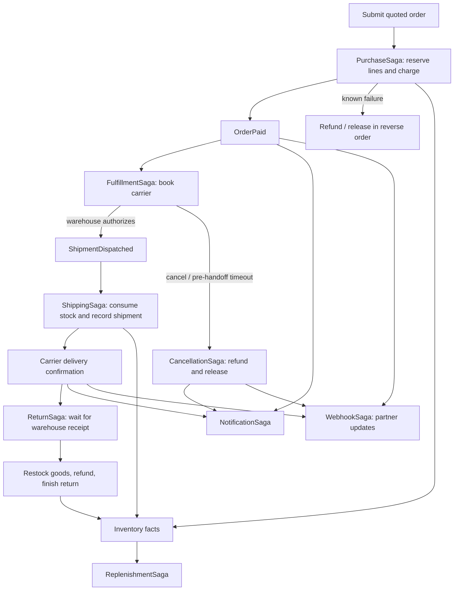

# Commerce: purchase, inventory and shipping

An executable Raku application built with RedSourcing. Three aggregates own
orders, stock and shipments; three projections report the store; **eight sagas**
coordinate reversible purchase work, physical handoff, delivery, cancellation,
returns, replenishment, notifications and webhooks.

## Run

From the repository root:

```sh
raku -Ilib examples/commerce/main.raku
```

The default demonstration uses in-memory SQLite. It runs delivery and a full
return, paid cancellation, payment rejection, lost-acknowledgement recovery and
low-stock replenishment. Money uses `Rat`; quotes include a fixed `5.00` shipping
fee. All providers are simulations with durable journal receipts.

Expected business outcomes:

```text
Delivered order: delivered
Returned order: returned
Cancelled order: cancelled
Declined order: cancelled
Recovered purchase: paid
Orders: 5; captured 187.8; refunded 52.8
```

The remaining paid orders are deliberately waiting for warehouse authorization.
No real payment, shipping, supplier or email request leaves the process. Webhooks
are simulated by default and can optionally use an HTTP endpoint.

## Domain and workflow boundaries

| Kind | Type | Responsibility |
| --- | --- | --- |
| Aggregate | `Commerce::Order` | Quote, payment confirmation, dispatch permission, cancellation and return lifecycle |
| Aggregate | `Commerce::Inventory` | One SKU in one warehouse; physical stock, holds, dispatches and return receipts |
| Aggregate | `Commerce::Shipment` | Carrier booking, physical handoff, delivery and shipping issues |
| Projection | `ShopDashboard` | Order states and captured/refunded money across streams |
| Projection | `WarehouseBoard` | On-hand, held and available stock across warehouses |
| Projection | `OrderNotifications` | Ordered in-app inbox for one order, reconstructed from domain facts |
| Saga | `PurchaseSaga` | Sequential reservations, payment, confirmation and reverse compensation |
| Saga | `FulfillmentSaga` | Carrier booking, handoff deadline and cancellable pre-handoff work |
| Saga | `ShippingSaga` | Stock movements after handoff, order shipment and delivery callback |
| Saga | `CancellationSaga` | Refund and release after carrier cancellation has settled |
| Saga | `ReturnSaga` | Return label, physical receipt, restocking, refund and completion |
| Saga | `ReplenishmentSaga` | Supplier delivery and stock receipt below a configured threshold |
| Saga | `NotificationSaga` | Independent, retryable customer updates |
| Saga | `WebhookSaga` | Independent partner deliveries with stable IDs, saved payloads and retries |



## Use the application API

The `Shop` facade initializes tables, creates required snapshots and creates every
per-order saga before submitting the first source event:

```raku
use RedSourcing;
use Commerce::App;

red-defaults 'SQLite', :database(':memory:');
my $shop = Shop.new.initialize;
$shop.product('coffee', :name<Coffee>, :price(12.50), :quantity(10));
$shop.purchase('order-1', :items{:coffee(2)}, :email<ana@example.test>);
$shop.drain;

# Warehouse approves the handoff; cancellation and this transition share
# the Order stream, so only one can win the paid-state version check.
$shop.order('order-1').authorize-dispatch;
$shop.drain;

# An external carrier integration would submit this confirmation.
$shop.shipment('order-1').deliver;
$shop.drain;
say $shop.order('order-1').^load.status; # delivered
```

Run with `-Iexamples/commerce/lib` when using those imports outside `main.raku`.
`drain` repeats bounded controller passes until no new facts are produced at the
supplied clock time. It does not sleep until future retries or timers become due.
For production integration, replace the simulated adapters and the physical
confirmation commands with authenticated warehouse/carrier inputs.

## Inventory and purchase

Quotes read registered product names/prices from inventory. Customers supply SKU
quantities, not authoritative prices. Submission freezes the quote; future price
changes do not alter the order. Reservations belong to an order and a specific
warehouse/SKU. Repeating a matching reservation is harmless; mismatched quantities
or insufficient available stock fail.

`on-hand` counts physical goods. `available` is `on-hand - held`. A reservation
reduces availability but not physical stock. Each successful reservation returns
its warehouse, SKU and order ID, which bind to `compensate-reserve-next`. A later
failure releases earlier lines in reverse order. Payment is attempted only after
all reservations succeed. Its inverse refunds the confirmed payment.

Purchase timeout waits for unknown outcomes to be reconciled before rollback.
A committed `OrderPaid` source event cancels the purchase timer even if its child
command acknowledgement was lost. The confirming child result then completes the
saga without refunding a payment that already reached the paid order.

## Cancellation and physical shipping

Paid cancellation is accepted **before dispatch authorization**:

```raku
$shop.order('order-1').request-cancellation(:reason('Wrong address'));
$shop.drain;
```

Fulfillment compensates the carrier booking. After that compensation finishes,
the controller records `ShipmentCancelled`. `CancellationSaga` waits for both the
request and shipment cancellation, then refunds payment, releases holds and
records `OrderCancelled`. Pre-payment failures follow purchase compensation and
are cancelled by the same controller bridge. Cancellation during an in-progress
purchase is not a customer command in this example.

Dispatch authorization changes the order from `paid` to `dispatching`. Customer
cancellation cannot also win that transition. Held stock cannot be released after
authorization. The shipment command checks authorization and reservations, then
records the simulated physical carrier handoff. Shipping consumes each line and
records the tracking code. A carrier callback records delivery.

Post-handoff failures and delivery deadlines report an issue; they do not pretend
that shipped goods returned or automatically refund an in-transit parcel. Use
`Shipment.resume-processing` to retry known failed stock/order recording. Unknown
service outcomes use the library's reconciliation API. The example assumes one
controller; it does not implement distributed leases or a physical warehouse API.

## Returns

The example supports one full-order return after delivery:

```raku
$shop.order('order-1').request-return(:reason('Changed my mind'));
$shop.drain;                    # Obtain a simulated return label
$shop.order('order-1').receive-return; # Warehouse acknowledges physical receipt
$shop.drain;
```

A request alone does not restock or refund. After warehouse receipt, the saga
restocks each original line exactly once, refunds the complete quote including
shipping, and finishes the order. A fourteen-day timer reports a missing return.

If a definite refund failure is exhausted, the order remains `return-received`
with its physical stock already recorded. After repair, `Order.resume-return`
emits a recovery fact; the saga resumes from saved indexes rather than repeating
successful restock steps. Partial returns, tax, multiple currencies, damaged goods
and alternative refund policies are outside this example's business model.

## Replenishment and notifications

Replenishment is keyed by warehouse and SKU. Available stock below the default
threshold `2` requests enough simulated supplier goods to reach target `12`.
The supplier receipt and inventory receipt each have a stable reference. Held
customer goods remain distinct from supplier arrivals. `Inventory.request-replenishment`
can retry a repaired, known failed supply request.

Notification has its own saga and retry policy so an email delay does not roll
back stock or payment. It sends updates for submitted, paid, shipped, delivered,
cancelled and refunded-return facts. Insertion-ordered actions still serialize
messages within that one notification saga.

### In-app inbox

`OrderNotifications` is a projection filtered by order identity. It derives
messages directly from committed order/shipment facts, including issue reports,
so email outages do not hide updates. Each message includes the source event ID,
type and emission timestamp; checkpoints resume without duplicating messages.

```raku
say .<message> for $shop.notifications('order-1').messages;
```

From the repository root, inspect the same inbox with:

```sh
raku -Ilib bin/red-sourcing.raku -f=examples/commerce/red-sourcing.rakuconf \
    load OrderNotifications --id=order-id=recovered
```

### Outgoing webhooks

`WebhookSaga` is separate from email delivery and purchase compensation. Each
order snapshots its endpoint before submission. It publishes submitted, paid,
shipped, delivered, cancelled, returned and issue facts. Every action saves an
immutable envelope with `event-id`, `type`, `stream`, `order-id`, `emitted-at` and
`data`. Delivery adds a stable `delivery-id`, also sent as the `Idempotency-Key`
HTTP header. Retries and controller restarts reuse both the ID and payload.

The default `simulated://commerce` adapter records `WebhookDelivered` and a
provider receipt without networking. Configure a real destination in application
code, optionally overriding or disabling it for a particular order:

```raku
my $shop = Shop.new(:webhook-url('https://partner.example/hooks')).initialize;
$shop.purchase('order-1', :items{:coffee(2)});
$shop.purchase('order-2', :items{:coffee(1)}, :webhook-url('')); # Disable this order
```

These snippets assume registered products and unused order IDs. For the demo,
`--webhook-url=URL` selects the destination; `COMMERCE_WEBHOOK_URL` supplies the
default for `Shop` and `main.raku`. Existing orders retain their saved endpoint.
`COMMERCE_WEBHOOK_TOKEN` optionally supplies a Bearer authorization header in the
controller process; the token is not stored in action arguments or receipts.

```sh
COMMERCE_WEBHOOK_URL=https://partner.example/hooks \
    raku -Ilib examples/commerce/main.raku
```

Real delivery uses [Cro's HTTP client](https://cro.raku.org/docs/reference/cro-http-client)
with a ten-second request budget and redirects disabled. HTTP 2xx completes the
action; 408, 429 and 5xx retry up to five attempts with exponential delays starting
at one second, capped at thirty. Other non-2xx responses are terminal rejections.
Transport failures are uncertain outcomes. The receiver must durably deduplicate
the delivery ID: it may accept a POST before the response or local receipt is
lost. Local receipts cannot make a remote HTTP effect transactional.

An exhausted delivery remains in `WebhookSaga.failures` and native action state;
it does not refund an order. Later actions progress after a known terminal failure.
An unresolved uncertain action blocks later deliveries until reconciliation. The
existing saga operator API does not requeue arbitrary exhausted actions; this is
one of the [API gaps](#saga-api-feedback).

```sh
raku -Ilib bin/red-sourcing.raku -f=examples/commerce/red-sourcing.rakuconf \
    saga-status WebhookSaga --id=order-id=recovered
raku -Ilib bin/red-sourcing.raku -f=examples/commerce/red-sourcing.rakuconf \
    list-events --class-name=Commerce::Events::WebhookDelivered
```

On affected macOS OpenSSL setups, set
`DYLD_LIBRARY_PATH=/opt/homebrew/opt/openssl@3/lib` for a controller using HTTP;
see the [native-library setup](../../docs/configuration.md#macos-native-libraries).

## Provider faults and recovery

`Commerce::Providers` registers payment, carrier, supplier, email and webhook
adapters. Simulated adapters write a provider fact and receipt in one database
transaction. HTTP webhooks run outside that transaction and save a receipt only
after acceptance. The receipt key comes from the saga's logical action and persists
across processes. Payments/refunds additionally deduplicate by business identity.

```raku
use Commerce::Providers;
provider-fault('payments', 'charge', :kind<retryable>); # reject before effect
provider-fault('payments', 'charge', :kind<permanent>); # do not retry
provider-fault('payments', 'charge', :kind<uncertain>); # commit, then lose reply
provider-fault('webhook', 'deliver', :kind<retryable>); # channel outage
```

The optional `:times` controls fault count. Fault switches are process-local test
controls; business/provider receipts are durable. A retry of an accepted operation
returns its saved receipt. Real services must provide equivalent durable
idempotency and outcome verification; this simulation does not make an HTTP
request transactional with the event journal.

## Persistent store, controller, CLI and monitor

Seed the persistent example store and run its controller in another terminal:

```sh
raku -Ilib examples/commerce/main.raku --database=examples/commerce/commerce.db
raku -Ilib examples/commerce/controller.raku
```

The controller uses this directory's `red-sourcing.rakuconf` and shares the seeded
store. `--database=PATH` and `-f=FILE` override it; `--once` drains one bounded run.
It caches discovered identities, routes new input and tracks wakeups. Restarting
rebuilds that cache from saved snapshots and control events.

From the example directory:

```sh
cd examples/commerce
raku -I../../lib ../../bin/red-sourcing.raku list-sagas
raku -I../../lib ../../bin/red-sourcing.raku saga-status PurchaseSaga --id=order-id=recovered
raku -I../../lib ../../bin/red-sourcing.raku command Order authorize-dispatch --id=order-id=recovered
raku -I../../lib ../../bin/red-sourcing.raku load WarehouseBoard
raku -I../../lib ../../bin/red-sourcing.raku web-monitor
```

The controller reacts to the authorization command. The independent monitor at
<http://127.0.0.1:3001/monitor> shows each saga's native actions, timers, compensations
and provider facts. CLI `advance` can run an individual saga, but the controller's
post-compensation domain bridge requires `controller.raku` or `Shop.tick`.
`work` processes stored commands rather than orchestrating all these sagas.

## Saga API feedback

This application uses the existing saga API; it does not add framework features.
The following additions would make it simpler:

| Missing facility | Effect in this example | Suggested direction |
| --- | --- | --- |
| Persisted completion/compensation/failure hooks | Controller polls terminal states and submits idempotent order/shipment commands | Journal terminal callback intents or publish a typed lifecycle event |
| Explicit step name/key | A repeated SKU operation needs a named method and a saved index; direct `REACT` effects are named `REACT` | `:step` / logical step key and recorded input |
| Child sagas, fan-out and joins | Separate workflows cooperate through domain facts; SKU loops are sequential | Durable children and explicit join outcomes |
| Compensation checkpoints/scopes | Handoff separates booking from delivery workflows | Commit one reversible scope without ending all saga work |
| Independent action queues | A blocked/future head action delays later actions, including timer-planned escalation | Named lanes, dependencies or priorities |
| Generic controller and next-wakeup/subscription API | Application duplicates routing and due-work discovery | Indexed discovery, event subscriptions and reusable scheduler |
| Operator retry for exhausted forward/inverse work | Domain recovery commands handle selected known failures; exhausted compensation lacks a general requeue API | Explicit retry/resume with durable provenance |
| Multi-controller ownership | This controller is single-process; provider deduplication does not claim the saga | Leases, fencing and multi-connection crash tests |

The provider contract, buffered reactions, automatic inverse binding, explicit
aggregate proxies and durable control recovery are sufficient to build these
flows. The missing pieces are primarily composition, scheduling and operator
recovery ergonomics. See the [roadmap](../../docs/next-steps.md).

## Verification

```sh
raku -Ilib t/37-commerce-example.rakutest
DYLD_LIBRARY_PATH=/opt/homebrew/opt/openssl@3/lib \
    raku -Ilib t/39-commerce-notifications.rakutest
```

The suite exercises full delivery/return, partial reservation failure, declines,
carrier refusal, cancellation order, dispatch protection, return repair, uncertain
payment reconciliation, deadlines, supplier receipt reuse, notification isolation,
read models and discovery in a fresh process. Its integration store is SQLite;
production concurrency and real external providers are not asserted.
The notification/webhook suite also runs a local HTTP receiver to check rejection,
retry envelopes, authorization headers, deduplication and checkpoint recovery.

## Docker stack

From the repository root:

```sh
docker compose -f examples/commerce/compose.yaml up --build -d
```

This uses the shared RedSourcing image, an isolated database volume and a
separate monitor at `http://127.0.0.1:3001/monitor`. See the
[Docker guide](../../docs/docker.md) for ports, services and persistent data.
