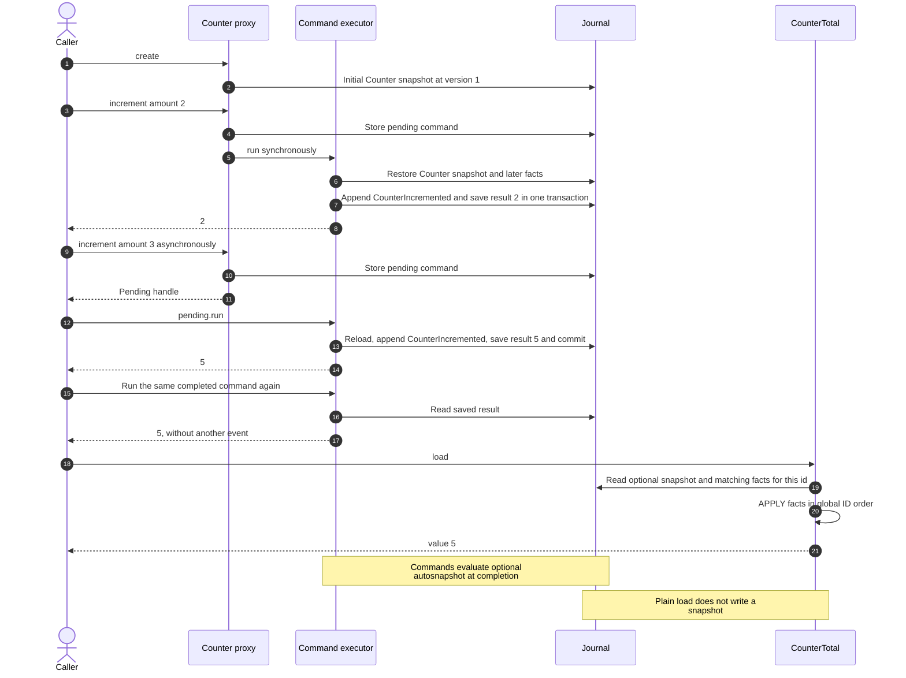

# Counter

A minimal aggregate, projection and persisted command example. Run from the root:

```sh
raku -Ilib examples/counter/main.raku
```

Expected output:

```text
2
Pending
5
5
5
```

[`CounterDemo`](lib/CounterDemo.rakumod) exports `CounterIncremented`, `Counter`
and `CounterTotal`. `increment` emits an event through the generated
`counter-incremented` helper. Its `amount` must be a positive integer.
`CounterTotal` filters by its own `id`. Re-running a completed deferred command
returns the saved result without another event.

## Sequence: submit, execute and read



## Persistent CLI walkthrough

The demo above uses an in-memory database. The configuration selects a separate
persistent `counter.db` inside this directory:

```sh
cd examples/counter
raku -I../../lib ../../bin/red-sourcing.raku init
raku -I../../lib ../../bin/red-sourcing.raku describe Counter
raku -I../../lib ../../bin/red-sourcing.raku create Counter --id=id=1
raku -I../../lib ../../bin/red-sourcing.raku command Counter increment --id=id=1 --data='{"amount":2}'
raku -I../../lib ../../bin/red-sourcing.raku command Counter increment --id=id=1 --async
raku -I../../lib ../../bin/red-sourcing.raku work
raku -I../../lib ../../bin/red-sourcing.raku load Counter --id=id=1
raku -I../../lib ../../bin/red-sourcing.raku load CounterTotal --id=id=1
raku -I../../lib ../../bin/red-sourcing.raku web-monitor
```

Create the aggregate once. The projection can load without an initial snapshot.
The monitor runs independently at <http://127.0.0.1:3001/monitor>. For an isolated
run, override `--database` or choose another ID; `init` does not clear an existing
store. From the root, pass `-f=examples/counter/red-sourcing.rakuconf` instead of
changing directory. See [the main quick start](../../README.md#quick-start).

## Docker stack

From the repository root:

```sh
docker compose -f examples/counter/compose.yaml up --build -d
```

This uses the shared RedSourcing image, an isolated database volume and a
separate monitor at `http://127.0.0.1:3001/monitor`. See the
[Docker guide](../../docs/docker.md) for ports, services and persistent data.
