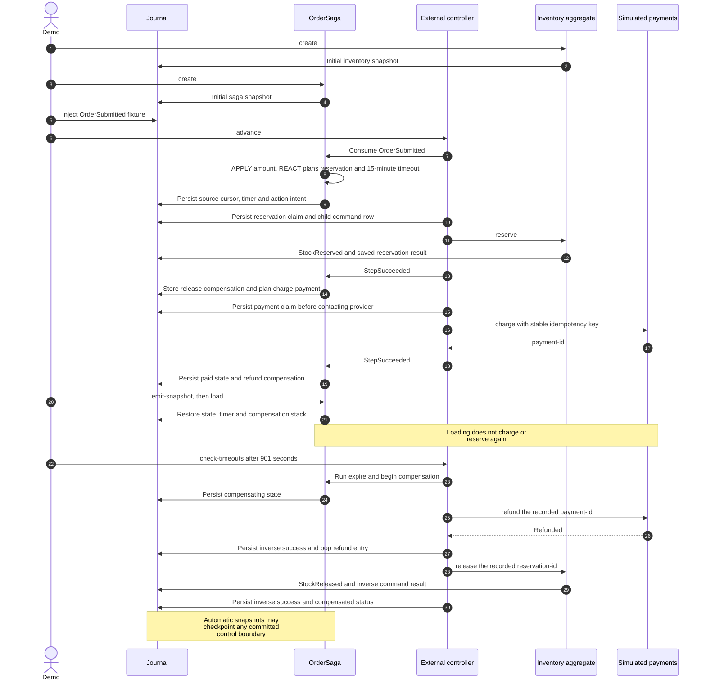

# Order saga

Run the complete example with one library import:

```sh
raku -Ilib examples/order-saga/main.raku
```

It reserves inventory, charges a simulated payment service, saves a snapshot,
reloads without effects, then advances the clock past the delivery deadline.
The saga refunds payment and releases inventory in reverse order.

```text
Payment confirmed: True
Registered compensations: 2
Stock reserved: True
Restored compensations: 2
After deadline: compensated
Stock reserved: False
charged 12.5
refunded payment-1
```

Money uses `Rat`. The payment adapter is an in-memory simulation of an idempotent
provider, not a real payment integration. An external controller must call
`.^advance` periodically. See [the saga API and recovery contract](../../docs/sagas.md)
and [the regression tests](../../t/13-sagas.rakutest).

## Sequence: successful steps, recovery and deadline compensation

The demonstration injects `OrderSubmitted` directly as its source fixture. An
application should produce that domain fact through an aggregate command.



## CLI and web monitor configuration

This directory includes `red-sourcing.rakuconf`, with a local SQLite store,
example modules, application paths and worker/monitor defaults. From this directory,
the CLI discovers it automatically instead of using the repository's root config:

```sh
cd examples/order-saga
raku -I../../lib ../../bin/red-sourcing.raku init
raku -I../../lib ../../bin/red-sourcing.raku describe OrderSaga
raku -I../../lib ../../bin/red-sourcing.raku create OrderSaga --id=order-id=order-1
raku -I../../lib ../../bin/red-sourcing.raku web-monitor
```

Open <http://127.0.0.1:3001/monitor>. New-store mode is enabled, so you can also
start the monitor first and explicitly run **init** in Operations. Relative paths
are resolved from the configuration file; from the repository root, select it
with `-f=examples/order-saga/red-sourcing.rakuconf`. Use `--port` to override the
monitor port when running multiple examples.

The standalone `main.raku` demonstration still uses a fresh in-memory database.
Its demo records do not populate this persistent CLI store. Create entities and
execute commands through the CLI or Operations to populate it.

[`OrderDomain.rakumod`](OrderDomain.rakumod) exports the saga, inventory aggregate
and events without running the demo or registering its in-memory payment adapter.
CLI `advance` needs a separately registered `payments` service adapter for payment
effects, just like any application-aware saga execution.

Application startup can use this same file through `red-sourcing-defaults`; see
[shared configuration](../../docs/configuration.md). The standalone demo
intentionally selects in-memory SQLite. The [CLI guide](../../docs/cli.md) and
[monitor guide](../../docs/web-monitor.md) explain persistent operations.

## Docker stack

From the repository root:

```sh
docker compose -f examples/order-saga/compose.yaml up --build -d
```

This uses the shared RedSourcing image, an isolated database volume and a
separate monitor at `http://127.0.0.1:3001/monitor`. See the
[Docker guide](../../docs/docker.md) for ports, services and persistent data.

## Reading through proxies

The inventory's `reserved is query` accessor can be read directly through its
proxy. The saga is explicitly loaded where the demo inspects its durable actions
and compensations.

Proxy command calls inside saga methods schedule durable actions.
`:service-retry{...}` configures their retry policy; compensator methods use the
same proxy syntax. Registered external adapters still use `self.^service(...)`.
