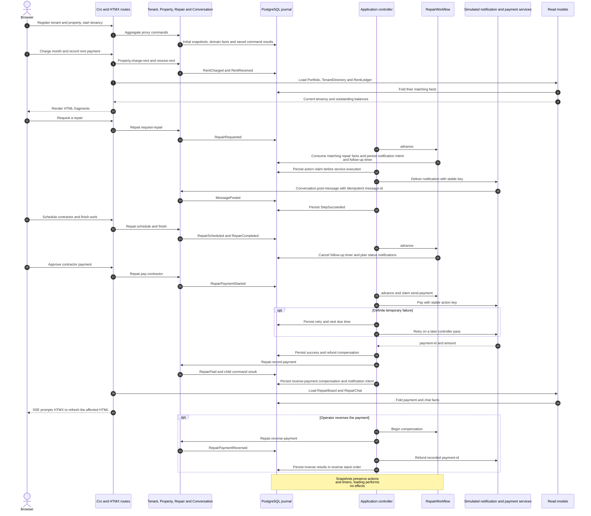

# Hearth: property management with RedSourcing

A working, local web application in English. Cro serves HTML; **HTMX 4.0.0**
submits forms and morphs live fragments. Server-sent events update other open tabs.
PostgreSQL retains all domain events, commands, chats, workflow controls and simulated
provider receipts across restarts.

## Run

Start a PostgreSQL server and install its libpq client library. From the repository
root, install the project dependencies:

```sh
zef install --deps-only .
zef install DB::Pg
# PostgreSQL must already be running. Adjust PGUSER to your database role.
export PGHOST=127.0.0.1 PGPORT=5432 PGUSER="$USER" PGDATABASE=hearth
createdb "$PGDATABASE"
raku -Ilib -Iexamples/real-estate/lib examples/real-estate/main.raku
```

On macOS, if startup aborts with `loading libcrypto in an unsafe way`, the
installed Raku OpenSSL binding is resolving Apple's incompatible library.
For Homebrew OpenSSL and libpq on Apple Silicon, run this command instead:

```sh
DYLD_LIBRARY_PATH=/opt/homebrew/opt/openssl@3/lib:/opt/homebrew/opt/libpq/lib \
    raku -Ilib -Iexamples/real-estate/lib examples/real-estate/main.raku
```

This sets the library search path for that process only. The same prefix applies
to the standalone console and Cro HTTP tests. For another Homebrew
installation, replace these with its OpenSSL and libpq `lib` directories.
The libpq path also resolves `Cannot locate native library pq` in DB::Pg.

Open <http://127.0.0.1:3000/> for Hearth. The generic RedSourcing monitor runs
independently on port 3001; see the command below.
HTMX, CSS and JavaScript are served locally; there is no frontend build or CDN
dependency at runtime. The default PostgreSQL database is `hearth`, selected by
`examples/real-estate/red-sourcing.rakuconf`. The app calls `red-sourcing-defaults` exported by `use RedSourcing` to load the
same configuration as the CLI and monitor, and applies `$settings.debug` to
Red's SQL logging scope. `PGDATABASE`, `PGHOST`, `PGPORT` and `PGUSER` override
the example defaults; libpq handles `PGPASSWORD` or a password file such as `.pgpass`.
See the [PostgreSQL connection environment reference](https://www.postgresql.org/docs/current/libpq-envars.html).
The database must exist first; initialization creates tables inside it.
The first run seeds four properties, three tenants, rent charges and two repairs.
Later runs restore that database without reseeding.

```sh
raku -Ilib -Iexamples/real-estate/lib examples/real-estate/main.raku \
    --port=3005 --database=hearth_other
# Empty portfolio instead of demo data:
raku -Ilib -Iexamples/real-estate/lib examples/real-estate/main.raku \
    --database=hearth_empty --/seed
```

Use `-f=PATH` to select another configuration. `--driver` and `--database` override
its values; `--host`/`--port` still control HTTP binding, not the database endpoint.
Other PostgreSQL databases in the examples above must already exist. For a temporary
SQLite demo, explicitly pass both flags:

```sh
raku -Ilib -Iexamples/real-estate/lib examples/real-estate/main.raku \
    --driver=SQLite --database=/tmp/hearth-sqlite.db
```

## Try a complete workflow

1. Open **Properties** and **Tenants** to register a home and a person. Start a
   tenancy on an available home. A property permits only one current tenancy.
2. Open **Rent & payments**, charge a month and record a partial or full payment.
   Overpayments, duplicate bank references and duplicate monthly charges fail as
   stored `Failed` commands. Outstanding bills prevent ending a tenancy.
3. Open **Repairs & chat** and request a repair. Open it to schedule a contractor,
   finish the work and approve the contractor payment.
4. Post messages as the agency, tenant or contractor. Open the same repair in
   another browser tab to see messages arrive without reloading.
5. On the repairs page, expand **Demo payment controls** and click **Fail next
   payment once** before paying a completed repair. The saga persists the failed
   attempt and retries it after one second, using the same provider key.
6. Inspect `http://127.0.0.1:3001/monitor?kind=saga` to see actions, attempts, compensations, timeouts
   and the persisted state. Restart the app while a retry is pending: the new
   controller resumes it. Inspection itself never advances a saga.
7. Once a repair is paid, **Reverse contractor payment** invokes compensators in
   reverse order: reverse the repair's payment record, then refund the provider.

An open repair gets a named follow-up timeout after 24 hours. Completing the work
cancels that instance's timeout. The controller checks deadlines once a second;
there is no browser dependency for executing retries or timeouts. Tests inject a
future `:now` to exercise this without waiting a day.

## Entity map

| Kind | Entity | Responsibility |
| --- | --- | --- |
| Aggregate | `Property` | Property details, tenancy, monthly rent charges and receipts |
| Aggregate | `Tenant` | Tenant registration and contact details |
| Aggregate | `Repair` | Request, schedule, completion and contractor payment state |
| Aggregate | `Conversation` | Repair chat and idempotent system messages |
| Projection | `Portfolio` | All properties and current occupants |
| Projection | `TenantDirectory` | Tenant contact list |
| Projection | `RentLedger` | Cross-property monthly balances and receipts |
| Projection | `RepairBoard` | Cross-property work queue |
| Projection | `RepairChat` | Messages filtered by repair ID |
| Saga | `RepairWorkflow` | Notifications, payment retries, inverses and follow-up deadlines |

Every saga subscribes to external repair events using
`where { .repair-id eq $!repair-id }`. Native `StepSucceeded`/`StepFailed` controls
belong to that saga's own stream. Controls contain the resulting domain and
runtime state, so reload works before the first saga snapshot and after later
controls. Replay does not invoke effects.

The routes call aggregate proxy commands; they never update a read model directly.
Reads load projections without emitting commands or snapshots. `APPLY` changes
state; `REACT` plans effects. A single process lock serializes HTTP reads, writes
and controller work around the shared database connection.

## Sequence: tenancy, rent, repair payment and chat



## Independent generic monitor

The app does not import `RedSourcing::Inspector`, register entity types with a
monitor, or host monitor routes. The monitor reads the database through
its own connection and works without this example's modules:

```sh
raku -Ilib bin/red-sourcing.raku web-monitor \
    -f=examples/real-estate/red-sourcing.rakuconf
```

The repository's root `red-sourcing.rakuconf` makes Hearth the default CLI target,
including its database, domain imports and worker/monitor settings. From the root:

```sh
raku -Ilib bin/red-sourcing.raku describe Conversation
raku -Ilib bin/red-sourcing.raku saga-status RepairWorkflow --id=repair-id=r-boiler
raku -Ilib bin/red-sourcing.raku web-monitor
```

This example also has its own `red-sourcing.rakuconf`, pointing at PostgreSQL `hearth`
and including `Estate::Domain`. From this directory, discovery selects it instead
of the repository root configuration:

```sh
cd examples/real-estate
raku -I../../lib ../../bin/red-sourcing.raku describe Conversation
raku -I../../lib ../../bin/red-sourcing.raku web-monitor
```

From the repository root, select it explicitly:

```sh
raku -Ilib bin/red-sourcing.raku web-monitor \
    -f=examples/real-estate/red-sourcing.rakuconf
```

Library paths resolve from the configuration directory; `hearth` is a server
database name. Root and example configurations share the same PostgreSQL environment
settings, so app, CLI and monitor connect to the same store. Create the database
first with `createdb`; new-store mode only allows an existing database with missing
tables to be initialized explicitly through **init**. Only the application seeds
the demonstration data. The `red-sourcing.rakuconf.example` template remains
available. See [configuration precedence and path rules](../../docs/cli.md#configuration-files).

Open <http://127.0.0.1:3001/monitor>. After installing RedSourcing,
the same CLI is `red-sourcing web-monitor -f=examples/real-estate/red-sourcing.rakuconf`;
`red-sourcing-monitor` also remains available as a standalone alias. On macOS,
use the OpenSSL environment prefix described above if needed.

The monitor discovers snapshots, saga controls, command targets and streams. It
shows minute charts for events/snapshots/retries/controls, volume and failures by
entity, snapshot frequency, and backlogs. Aggregate/projection state is labelled
as the last snapshot; current saga state comes from the latest native control.
Monitor inspection never imports handlers or executes effects; Operations runs
explicit submissions in separate processes. See
[`../../docs/web-monitor.md`](../../docs/web-monitor.md) for metric definitions and limits.

## Performance

Read models are cached against the journal head and copied before returning them;
`Rat` values remain exact and callers cannot mutate cached state. The controller
reads only newly committed rows and wakes only repair workflows whose inputs
changed or whose retry/timeout is due. Its scheduler retains the cursor from
before a pass so effects emitted later in that pass remain discoverable.
Restarting reconstructs the schedule from durable records.

Controller work is coalesced by journal revision and due time. Idle polling and
read-model caching avoid repeating unrelated replay. Measure your own store when
changing its size, driver or workload.

## Tests

```sh
raku -Ilib t/14-real-estate-example.rakutest
# Opt-in PostgreSQL regressions, using a dedicated existing test database:
RED_SOURCING_TEST_PG_DATABASE=hearth_test \
    raku -Ilib t/14-real-estate-example.rakutest
# PGHOST/PGPORT/PGUSER select the test server. Each case uses a temporary schema.
# Optional Cro request/response tests:
raku -Ilib -Iexamples/real-estate/lib t/16-web-real-estate-http.rakutest
# Optional browser tests, against a fresh seeded server:
npm install
npm exec -- playwright install chromium
HEARTH_URL=http://127.0.0.1:3000 CONSOLE_URL=http://127.0.0.1:3001 \
    npm run test:browser
```

The default test suite still uses in-memory SQLite and needs no PostgreSQL server.
The opt-in PostgreSQL run covers the same rent, projections, chat, restart/retry,
compensation and timeout cases, then removes only schemas created by that test.
App, CLI and monitor use `store-driver` to select Red's Pg connection with JSON
compatibility: Red encodes JSON once, and JSON paths/scalar comparisons are bound
correctly for PostgreSQL. This avoids double encoding by DB::Pg's JSON converter.

## Demo boundaries

This is an executable architecture example, not a deployed rental business.
It binds to loopback by default. Chat roles are explicit demo choices, not
authenticated users. The web layer escapes user content, checks a per-process
form token and provides a restrictive CSP. Add authentication, per-property
authorization, durable user sessions and request limits before exposing it.

Payments are simulated in `estate_demo_provider_receipt`. Notifications create
chat messages; they do not send email, SMS or push notifications. The simulated
provider retains idempotency keys in PostgreSQL and distinguishes a known temporary
failure from an unknown outcome. Replace these adapters with real integrations
that provide the same durable idempotency and reconciliation guarantees.

The example runs one saga controller, waiting one second after each pass so slow
replays do not accumulate timer callbacks. The shared lock does not provide leases
between multiple controller processes; distributed execution remains a library
next step. A reversed workflow is terminal, so create a new repair for a new
payment attempt after reversal. The same repair does not start another saga.

Browser screenshots are written to `/tmp/redsourcing-hearth-screenshots` by
default. Override `SCREENSHOT_DIR` to save them elsewhere.

## Docker stack

From the repository root:

```sh
docker compose -f examples/real-estate/compose.yaml up --build -d
```

This uses the shared RedSourcing image, an isolated database volume and a
separate monitor at `http://127.0.0.1:3001/monitor`. See the
[Docker guide](../../docs/docker.md) for ports, services and persistent data.
