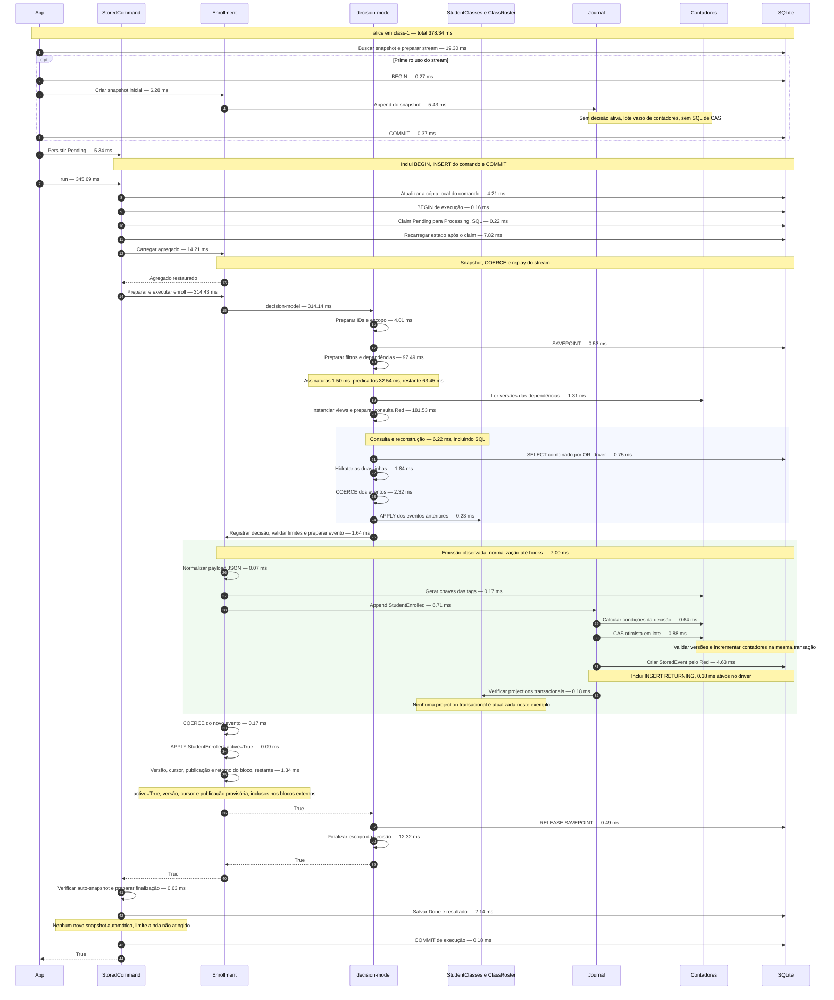

# Comando e emissão de eventos: sequência medida

Amostra: primeira matrícula de Alice em class-1 no demo real da escola. SQLite em memória,
RAKUDO_RAKUAST=0, 2026-10-20. Uma execução instrumentada após aquecimento,
com saída conferida contra a execução sem instrumentação. Não é uma mediana por comando.

Tempos inclusivos: filhos já estão no tempo do pai. Os blocos de preparação são intervalos
entre os pontos observados, incluindo o trabalho Raku desse intervalo. O restante de filtros
inclui análise de dependências, varreduras do AST e outros preparos não cronometrados
separadamente. SQL é tempo ativo de preparar/executar/ler no driver, não o tempo total de
uma consulta Red. Hidratação, COERCE e handlers são mostrados separadamente.



O caminho completo levou **378.34 ms**, dos quais **345.69 ms**
dentro de `StoredCommand.run` e **314.14 ms** dentro de `decision-model`.
Os **22 statements** somaram **5.55 ms** ativos no driver.
Tempos Raku e bookkeeping entre chamadas explicam as diferenças entre a soma das etapas e
os blocos externos. Não some os tempos inclusivos entre si.

A emissão inclui o envelope causal (`command-id` e, quando houver, `action-id`) antes do
INSERT. Esse preparo não tem cronômetro próprio e está incluído no append. Depois do INSERT,
o novo evento é aplicado ao agregado. As projections comuns de aluno e turma são
reconstruídas em suas leituras; não são atualizadas automaticamente por essa emissão.

O diagrama mostra o caminho de sucesso síncrono. Rejeições de negócio fazem rollback e
salvam o comando como Failed; conflitos otimistas podem repetir a execução. Esses caminhos
não têm os mesmos tempos. Veja as amostras de rejeição e cancelamento no
[diagrama do demo completo](demo-sequence.md).

Para reproduzir:

```sh
python3 tools/profile-school-demo.py --runs=3 --output-dir=/tmp/school-command-profile
```

O diretório conterá `command-sequence.md`, `command-measurement.json` e os traces completos.
