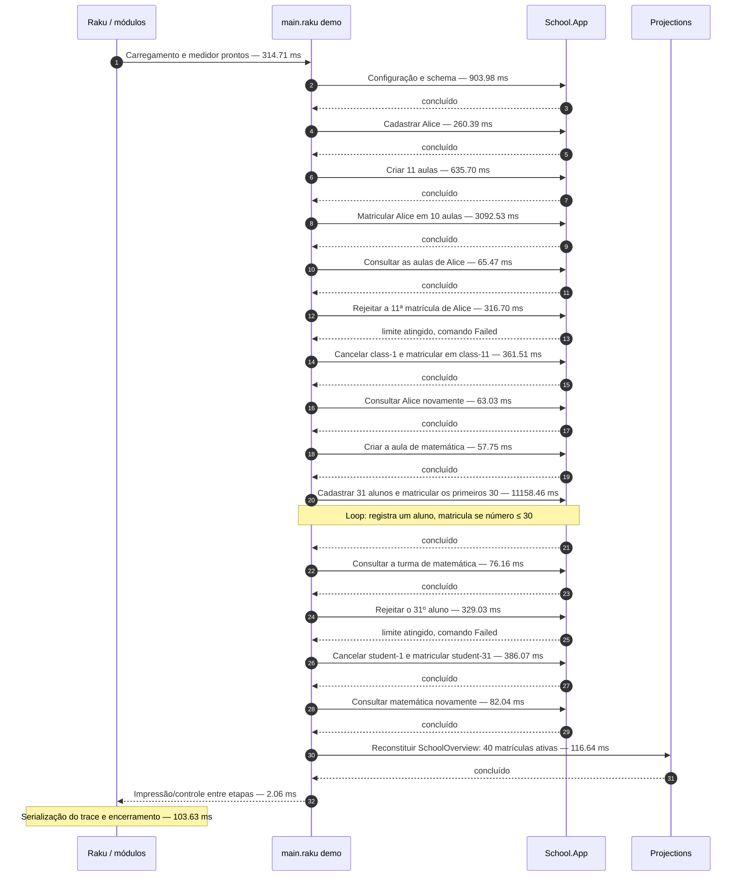
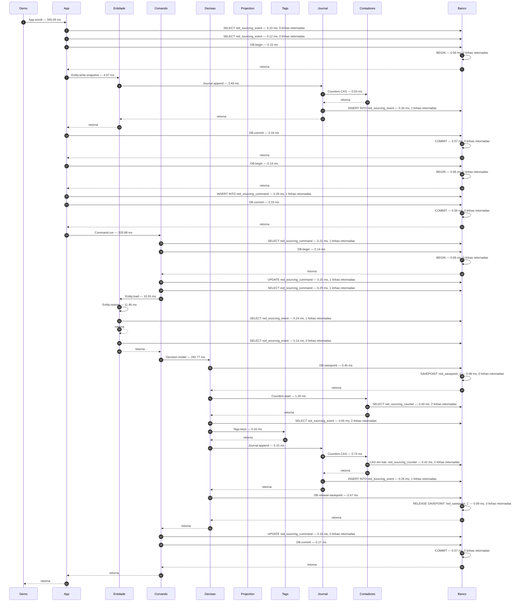
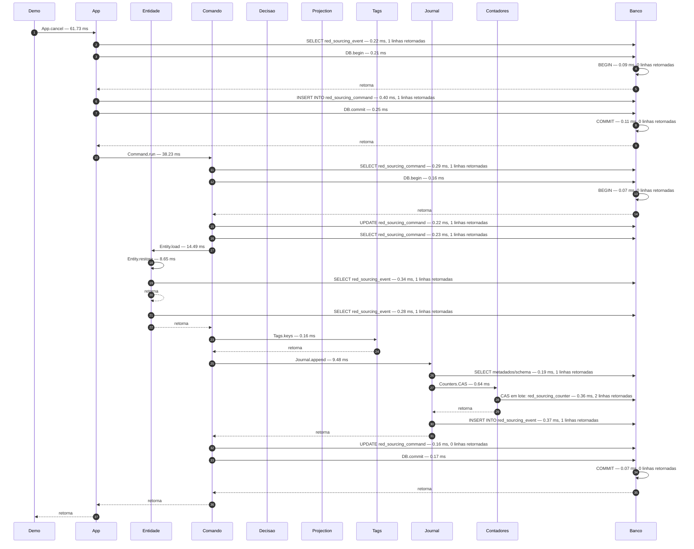
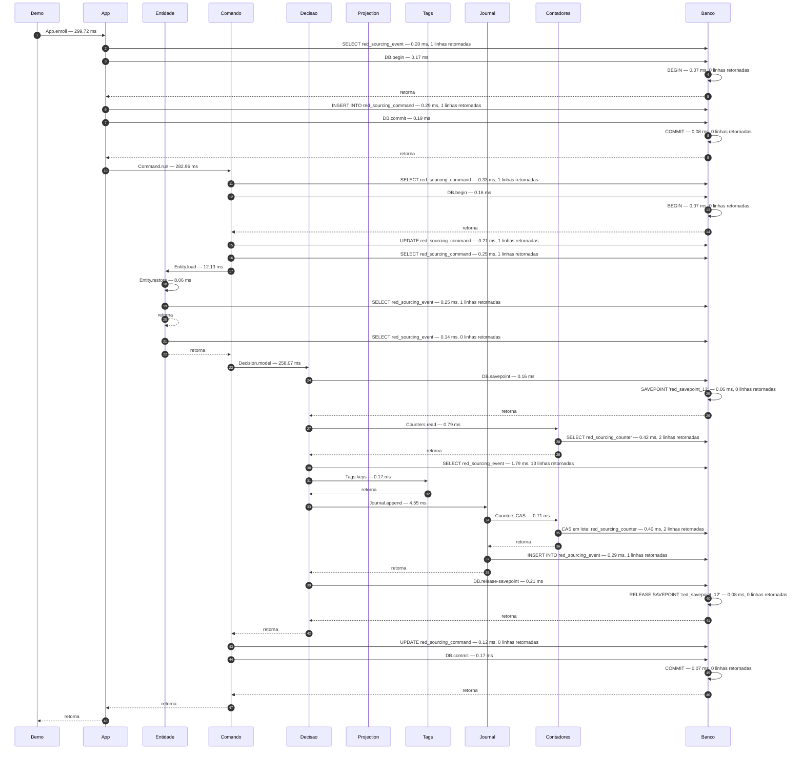
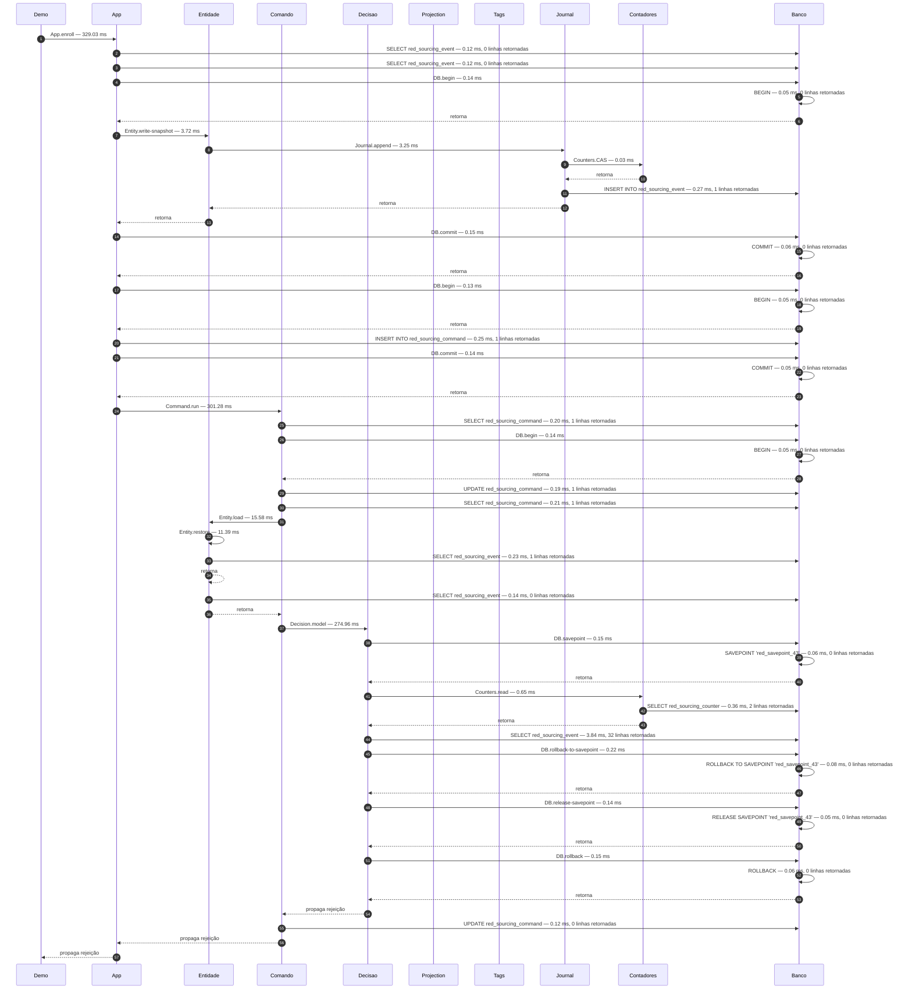

# Sequência medida do demo school

Execução real de `examples/school/main.raku demo`, SQLite em memória e precompilação aquecida.

Medição local de 2026-10-20. O demo completo cadastra 32 alunos, cria 12 aulas e tenta 44 matrículas. O benchmark anterior de 3,45 s cobria uma aula, dez cadastros e dez matrículas.

Processo sem instrumentação: **18.110 s** (mediana de 3 execuções).
Processo instrumentado: **18.333 s** (mediana).
O diagrama usa uma execução real representativa: **18.333 s** no processo, dos quais **17.908 s** dentro do demo.

Os tempos das chamadas são inclusivos: filhos já fazem parte do tempo do pai. Nos blocos SQL, o tempo soma preparação, execução e leitura das linhas no driver; a hidratação e os handlers ficam no estágio que consome essas linhas. BEGIN/COMMIT/ROLLBACK aparecem separadamente. Linhas são resultados retornados, não linhas afetadas por UPDATE. A instrumentação também tem custo.

## Demo completo



| Etapa | Chamadas | Tempo inclusivo (ms) |
| --- | ---: | ---: |
| Configuração e schema | 1 | 903.98 |
| Cadastrar Alice | 1 | 260.39 |
| Criar 11 aulas | 11 | 635.70 |
| Matricular Alice em 10 aulas | 10 | 3092.53 |
| Consultar as aulas de Alice | 1 | 65.47 |
| Rejeitar a 11ª matrícula de Alice | 1 | 316.70 |
| Cancelar class-1 e matricular em class-11 | 2 | 361.51 |
| Consultar Alice novamente | 1 | 63.03 |
| Criar a aula de matemática | 1 | 57.75 |
| Cadastrar 31 alunos e matricular os primeiros 30 | 61 | 11158.46 |
| Consultar a turma de matemática | 1 | 76.16 |
| Rejeitar o 31º aluno | 1 | 329.03 |
| Cancelar student-1 e matricular student-31 | 2 | 386.07 |
| Consultar matemática novamente | 1 | 82.04 |
| Reconstituir SchoolOverview: 40 matrículas ativas | 1 | 116.64 |

## Uma matrícula, por dentro

Primeira matrícula de Alice em class-1, incluindo a criação inicial do stream de Enrollment. A consulta OR reconstrói StudentClasses(alice) e ClassRoster(class-1). O bloco valida existência e limites e emite StudentEnrolled. O comando passa de Pending para Processing e Done. Cada seta corresponde a uma chamada observada; os SELECTs são identificados pela tabela consultada.



## Rejeição da 11ª aula


## Cancelamento



## Matrícula após o cancelamento



## Rejeição do 31º aluno



## Volume observado

- 1816 statements preparados; 411.72 ms somados no driver.
- 32 alunos, 12 aulas, 90 comandos: 88 concluídos e duas rejeições de negócio.
- 88 eventos de domínio e 86 snapshots iniciais; 40 matrículas ativas no fim.
- Em snapshots sem decisão ativa, Counters.CAS recebe um lote vazio e retorna sem SQL; nenhum contador é alterado.
- As decisões leem contadores e uma consulta OR para StudentClasses + ClassRoster; o append valida os contadores com CAS e a unicidade (stream, version).
- O demo habilita a opção flow-tracing na configuração, mas não abre o monitor nem reconstrói as projections de flow/métricas; apenas grava a causalidade nos registros.

## Reprodução

```sh
python3 tools/profile-school-demo.py --runs=3 --output-dir=/tmp/school-demo-profile
```

Os JSONs nesse diretório contêm timestamps, relações pai/filho, SQL e tempos de cada chamada. O script aquece a execução normal e a instrumentada antes de medir e verifica que ambas produzem a mesma saída.

Runtime utilizado:

```text
Welcome to Rakudo™ v2026.09-198-g50379ea28a.
Implementing the Raku® Programming Language v6.d.
Built on MoarVM version 2026.09-38-g597c5351b.
RAKUDO_RAKUAST=0
```

## Acumulado por estágio

Os acumulados abaixo se sobrepõem. Decision.model inclui construção dos predicados, reconstrução das duas projections, validação de negócio e emissão quando permitida. O tempo ativo no driver SQL exclui a hidratação e o trabalho Raku entre as leituras.

| Estágio | Chamadas | Tempo inclusivo acumulado (ms) |
| --- | ---: | ---: |
| Command.run | 90 | 14217.40 |
| App.enroll | 44 | 13744.61 |
| Decision.model | 44 | 11515.35 |
| App.add-student | 32 | 2041.10 |
| Entity.load | 95 | 1605.05 |
| Entity.restore | 95 | 826.88 |
| Journal.append | 174 | 756.57 |
| App.add-class | 12 | 693.14 |
| SQL | 1816 | 411.72 |
| Entity.write-snapshot | 86 | 370.41 |
| Projection.replay | 5 | 365.35 |
| App.classroom | 2 | 158.20 |
| App.student | 2 | 128.50 |
| App.cancel | 2 | 115.49 |
| Counters.CAS | 174 | 63.36 |
| DB.commit | 264 | 40.98 |
| DB.begin | 266 | 38.49 |
| Counters.read | 44 | 29.37 |
| Tags.keys | 88 | 14.82 |
| DB.release-savepoint | 44 | 7.93 |
| App.initialize | 1 | 7.77 |
| DB.savepoint | 44 | 7.37 |
| DB.rollback-to-savepoint | 2 | 0.74 |
| DB.rollback | 2 | 0.52 |

## Cada chamada do demo

As colunas Comando e Decisão já estão incluídas no total da chamada. O SQL é a soma do tempo ativo no driver dentro dessa operação.

| Chamada | Total (ms) | Comando (ms) | Decisão (ms) | SQL (ms) | Statements | Resultado |
| --- | ---: | ---: | ---: | ---: | ---: | --- |
| App.initialize() | 7.77 | 0.00 | 0.00 | 0.00 | 2 | ok |
| App.add-student(alice, Alice) | 260.39 | 175.66 | 0.00 | 5.27 | 19 | ok |
| App.add-class(class-1, Class 1) | 60.43 | 34.29 | 0.00 | 3.43 | 18 | ok |
| App.add-class(class-2, Class 2) | 63.11 | 30.85 | 0.00 | 3.32 | 18 | ok |
| App.add-class(class-3, Class 3) | 55.59 | 28.72 | 0.00 | 3.02 | 18 | ok |
| App.add-class(class-4, Class 4) | 60.55 | 32.30 | 0.00 | 3.16 | 18 | ok |
| App.add-class(class-5, Class 5) | 56.66 | 32.85 | 0.00 | 3.28 | 18 | ok |
| App.add-class(class-6, Class 6) | 56.01 | 32.01 | 0.00 | 3.08 | 18 | ok |
| App.add-class(class-7, Class 7) | 56.50 | 33.31 | 0.00 | 6.09 | 18 | ok |
| App.add-class(class-8, Class 8) | 55.37 | 28.47 | 0.00 | 3.06 | 18 | ok |
| App.add-class(class-9, Class 9) | 56.33 | 29.79 | 0.00 | 3.13 | 18 | ok |
| App.add-class(class-10, Class 10) | 57.81 | 31.39 | 0.00 | 2.95 | 18 | ok |
| App.add-class(class-11, Class 11) | 57.03 | 32.31 | 0.00 | 3.10 | 18 | ok |
| App.enroll(alice, class-1) | 345.09 | 320.88 | 292.77 | 4.34 | 22 | ok |
| App.enroll(alice, class-2) | 302.84 | 278.17 | 250.63 | 4.53 | 22 | ok |
| App.enroll(alice, class-3) | 293.19 | 269.29 | 242.72 | 4.31 | 22 | ok |
| App.enroll(alice, class-4) | 303.59 | 275.07 | 250.58 | 4.77 | 22 | ok |
| App.enroll(alice, class-5) | 304.08 | 278.13 | 250.29 | 4.82 | 22 | ok |
| App.enroll(alice, class-6) | 309.46 | 284.49 | 255.70 | 5.17 | 22 | ok |
| App.enroll(alice, class-7) | 308.13 | 282.45 | 253.31 | 5.27 | 22 | ok |
| App.enroll(alice, class-8) | 309.67 | 280.71 | 256.28 | 5.29 | 22 | ok |
| App.enroll(alice, class-9) | 307.53 | 279.69 | 256.23 | 5.14 | 22 | ok |
| App.enroll(alice, class-10) | 308.64 | 280.69 | 256.86 | 5.28 | 22 | ok |
| App.student(alice) | 65.47 | 0.00 | 0.00 | 1.63 | 2 | ok |
| App.enroll(alice, class-11) | 316.70 | 290.80 | 260.57 | 5.18 | 21 | rejeitado |
| App.cancel(alice, class-1) | 61.73 | 38.23 | 0.00 | 3.39 | 15 | ok |
| App.enroll(alice, class-11) | 299.72 | 282.96 | 258.07 | 5.12 | 18 | ok |
| App.student(alice) | 63.03 | 0.00 | 0.00 | 1.74 | 2 | ok |
| App.add-class(math, Mathematics) | 57.75 | 34.35 | 0.00 | 3.08 | 18 | ok |
| App.add-student(student-1, Student 1) | 55.17 | 29.01 | 0.00 | 2.89 | 18 | ok |
| App.enroll(student-1, math) | 294.13 | 267.56 | 243.07 | 4.06 | 22 | ok |
| App.add-student(student-2, Student 2) | 56.41 | 32.95 | 0.00 | 3.05 | 18 | ok |
| App.enroll(student-2, math) | 298.14 | 270.91 | 246.53 | 4.55 | 22 | ok |
| App.add-student(student-3, Student 3) | 55.31 | 31.68 | 0.00 | 2.92 | 18 | ok |
| App.enroll(student-3, math) | 293.40 | 270.16 | 242.96 | 4.10 | 22 | ok |
| App.add-student(student-4, Student 4) | 58.55 | 32.59 | 0.00 | 2.94 | 18 | ok |
| App.enroll(student-4, math) | 294.87 | 271.42 | 245.01 | 4.17 | 22 | ok |
| App.add-student(student-5, Student 5) | 58.25 | 32.05 | 0.00 | 2.83 | 18 | ok |
| App.enroll(student-5, math) | 306.54 | 281.79 | 252.93 | 4.54 | 22 | ok |
| App.add-student(student-6, Student 6) | 58.23 | 28.94 | 0.00 | 2.96 | 18 | ok |
| App.enroll(student-6, math) | 300.80 | 274.39 | 250.56 | 4.36 | 22 | ok |
| App.add-student(student-7, Student 7) | 54.59 | 28.15 | 0.00 | 6.11 | 18 | ok |
| App.enroll(student-7, math) | 300.62 | 272.40 | 249.12 | 4.46 | 22 | ok |
| App.add-student(student-8, Student 8) | 56.59 | 28.42 | 0.00 | 2.83 | 18 | ok |
| App.enroll(student-8, math) | 300.38 | 274.46 | 251.58 | 4.55 | 22 | ok |
| App.add-student(student-9, Student 9) | 57.19 | 30.33 | 0.00 | 2.93 | 18 | ok |
| App.enroll(student-9, math) | 303.83 | 277.79 | 254.36 | 4.70 | 22 | ok |
| App.add-student(student-10, Student 10) | 55.13 | 27.89 | 0.00 | 2.75 | 18 | ok |
| App.enroll(student-10, math) | 303.32 | 276.63 | 252.48 | 4.81 | 22 | ok |
| App.add-student(student-11, Student 11) | 59.22 | 32.45 | 0.00 | 2.67 | 18 | ok |
| App.enroll(student-11, math) | 301.69 | 279.09 | 252.13 | 4.73 | 22 | ok |
| App.add-student(student-12, Student 12) | 58.17 | 30.79 | 0.00 | 2.66 | 18 | ok |
| App.enroll(student-12, math) | 308.36 | 284.86 | 257.61 | 5.03 | 22 | ok |
| App.add-student(student-13, Student 13) | 55.44 | 31.38 | 0.00 | 2.70 | 18 | ok |
| App.enroll(student-13, math) | 307.05 | 284.54 | 258.41 | 4.92 | 22 | ok |
| App.add-student(student-14, Student 14) | 56.68 | 32.80 | 0.00 | 2.75 | 18 | ok |
| App.enroll(student-14, math) | 307.70 | 280.98 | 258.01 | 6.77 | 22 | ok |
| App.add-student(student-15, Student 15) | 55.35 | 27.60 | 0.00 | 2.67 | 18 | ok |
| App.enroll(student-15, math) | 307.91 | 280.88 | 257.63 | 5.28 | 22 | ok |
| App.add-student(student-16, Student 16) | 60.05 | 31.15 | 0.00 | 2.75 | 18 | ok |
| App.enroll(student-16, math) | 308.52 | 286.37 | 260.59 | 5.16 | 22 | ok |
| App.add-student(student-17, Student 17) | 54.09 | 31.05 | 0.00 | 5.89 | 18 | ok |
| App.enroll(student-17, math) | 310.31 | 287.27 | 260.44 | 5.35 | 22 | ok |
| App.add-student(student-18, Student 18) | 54.87 | 27.52 | 0.00 | 2.57 | 18 | ok |
| App.enroll(student-18, math) | 380.36 | 352.30 | 329.51 | 5.46 | 22 | ok |
| App.add-student(student-19, Student 19) | 60.57 | 32.77 | 0.00 | 2.82 | 18 | ok |
| App.enroll(student-19, math) | 310.20 | 287.98 | 261.69 | 5.59 | 22 | ok |
| App.add-student(student-20, Student 20) | 54.34 | 31.63 | 0.00 | 2.59 | 18 | ok |
| App.enroll(student-20, math) | 313.00 | 286.56 | 263.01 | 5.84 | 22 | ok |
| App.add-student(student-21, Student 21) | 61.14 | 31.47 | 0.00 | 2.65 | 18 | ok |
| App.enroll(student-21, math) | 314.41 | 291.27 | 265.43 | 5.83 | 22 | ok |
| App.add-student(student-22, Student 22) | 56.57 | 28.41 | 0.00 | 2.73 | 18 | ok |
| App.enroll(student-22, math) | 315.58 | 288.70 | 265.85 | 5.93 | 22 | ok |
| App.add-student(student-23, Student 23) | 60.96 | 32.64 | 0.00 | 2.75 | 18 | ok |
| App.enroll(student-23, math) | 316.66 | 294.32 | 267.53 | 6.09 | 22 | ok |
| App.add-student(student-24, Student 24) | 55.57 | 27.31 | 0.00 | 2.67 | 18 | ok |
| App.enroll(student-24, math) | 326.58 | 299.73 | 275.95 | 6.26 | 22 | ok |
| App.add-student(student-25, Student 25) | 59.18 | 34.88 | 0.00 | 3.00 | 18 | ok |
| App.enroll(student-25, math) | 323.02 | 294.96 | 269.85 | 8.47 | 22 | ok |
| App.add-student(student-26, Student 26) | 63.13 | 33.57 | 0.00 | 2.94 | 18 | ok |
| App.enroll(student-26, math) | 321.22 | 298.99 | 270.91 | 6.42 | 22 | ok |
| App.add-student(student-27, Student 27) | 57.66 | 28.50 | 0.00 | 2.80 | 18 | ok |
| App.enroll(student-27, math) | 326.26 | 299.69 | 277.30 | 6.54 | 22 | ok |
| App.add-student(student-28, Student 28) | 56.03 | 28.59 | 0.00 | 2.83 | 18 | ok |
| App.enroll(student-28, math) | 329.37 | 302.42 | 279.49 | 6.63 | 22 | ok |
| App.add-student(student-29, Student 29) | 54.47 | 31.73 | 0.00 | 2.60 | 18 | ok |
| App.enroll(student-29, math) | 324.65 | 296.93 | 273.54 | 6.89 | 22 | ok |
| App.add-student(student-30, Student 30) | 61.39 | 32.41 | 0.00 | 2.77 | 18 | ok |
| App.enroll(student-30, math) | 325.80 | 303.78 | 276.50 | 6.87 | 22 | ok |
| App.add-student(student-31, Student 31) | 60.42 | 31.39 | 0.00 | 2.75 | 18 | ok |
| App.classroom(math) | 76.16 | 0.00 | 0.00 | 3.07 | 2 | ok |
| App.enroll(student-31, math) | 329.03 | 301.28 | 274.96 | 6.56 | 21 | rejeitado |
| App.cancel(student-1, math) | 53.76 | 36.86 | 0.00 | 2.67 | 15 | ok |
| App.enroll(student-31, math) | 332.26 | 310.21 | 286.41 | 6.90 | 18 | ok |
| App.classroom(math) | 82.04 | 0.00 | 0.00 | 3.41 | 2 | ok |
| SchoolOverview.load() | 116.64 | 0.00 | 0.00 | 7.99 | 2 | ok |
