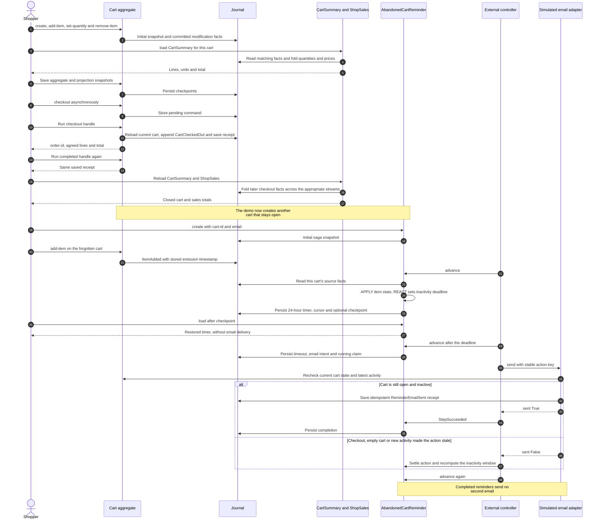

# Shopping cart example

Run from the repository root:

```sh
raku -Ilib -Iexamples/shopping-cart examples/shopping-cart/main.raku
```

The demo uses a fresh in-memory SQLite database. It creates a cart, adds products,
changes a quantity, removes a product, saves aggregate and projection snapshots,
then executes checkout as a deferred command. A second cart demonstrates sales
across streams. The sales demo ends with two orders, five units sold and revenue `37.75`.
A third cart stays open; its saga restores a snapshot and simulates a reminder
email after advancing the clock by one day, without sleeping.
The event-store API and Red's database configuration are available through
`use RedSourcing`; roles, traits and stored commands need no separate import.

## Cart commands

`Cart` is an aggregate identified by `cart-id`. Its first snapshot represents an
empty, open cart. Create it before submitting commands:

```raku
my $cart = Cart.^with-ids: :cart-id<ana>;
$cart.^create;
$cart.add-item: :product-id<coffee>, :name<Coffee>, :unit-price(12.50), :quantity(2);
$cart.add-item: :product-id<mug>, :name<Mug>, :unit-price(8.90);
$cart.set-quantity: :product-id<coffee>, :quantity(3);
$cart.remove-item: :product-id<mug>;
my %order = $cart.checkout;
say %order<order-id>;
say %order<total>; # 37.5
```

- `add-item`: adds a product or increments an existing line. Quantity defaults to
  one. A repeated product ID must retain the same name and price; remove the line
  first to replace it with a different price.
- `set-quantity`: sets the absolute quantity of an existing product. An unchanged
  quantity succeeds without emitting an event.
- `remove-item`: removes the entire product line. Use this instead of quantity zero.
- `checkout`: rejects an empty cart, records a receipt and closes the cart.
  A closed cart rejects all further mutations and new checkout commands.

Prices and totals use `Rat`. Prices must be positive and have at most two decimal
places, so decimal JSON serialization preserves the amounts used in this example.
Quantities are positive integers. Product IDs and names cannot be empty. Domain
validation runs on the aggregate loaded at execution time.

Each successful change appends one event to the cart's stream with the next
version. Handlers call `item-added`, `quantity-changed`, `item-removed` and
`cart-checked-out`, generated from their `APPLY` candidates on the aggregate.
These methods fill `cart-id`, persist and apply each event, and advance the live
version and cursor. Command results use the updated state. `QuantityChanged` and
`ItemRemoved` record the original quantity and price, allowing projections to
compute their deltas directly from the event.

`CartCheckedOut` records the cart ID, order ID, product lines, agreed prices,
quantities and total. Lines are ordered by product ID. The order ID combines the
cart ID and checkout stream version. Checkout is a local order confirmation;
the example does not charge a payment provider or reserve inventory.

## Deferred execution and retry

```raku
my $pending = $cart.checkout: :!sync;
my %receipt = $pending.run;
my %same-receipt = $pending.run;
```

Deferred checkout uses the contents when `.run` executes. Submitting it does not
freeze the cart. Successful execution writes the checkout event, result and
command completion in the executor's existing transaction. Running the same
completed command again returns its saved receipt without another checkout.
Submitting a new checkout command after closure fails.

Invalid argument constraints fail before a command is stored. Domain failures,
such as an unknown product or an empty cart, create a terminal `Failed` record:
the exception reaches the caller and the error stays in command history. A new
submission revalidates the current cart state. Sagas can coordinate retries.

## Projections and snapshots

`CartSummary` selects events for one cart through the `APPLY` signatures. It shows
the number of distinct product lines, total units, total price and checkout state.
Its `summary` method is declared `is query` and can be called directly on the proxy:

```raku
my $proxy = CartSummary.^with-ids: :cart-id<ana>;
my %summary = $proxy.summary;
say %summary<item-count>;
say %summary<total>;
my $loaded = $proxy.^load;
$loaded.^emit-snapshot;
```

The projection may load without a snapshot and starts at zero for an identity
with no history. After a checkpoint, it replays only later applicable events.
`Cart.^load.^emit-snapshot` checkpoints an aggregate, including its product lines.

`ShopSales` consumes checkout events from every cart stream and reports order
count, units sold and revenue. It ignores cart modifications and both types of
snapshot, so an open cart does not count as a sale:

```raku
my $sales = ShopSales.^with-ids.^load;
say $sales.orders;
say $sales.items-sold;
say $sales.revenue;
$sales.^emit-snapshot;
```

## Abandoned cart reminder saga

`AbandonedCartReminder` consumes changes for its own `cart-id`. Create it with
an email address before the controller first advances it:

```raku
use RedSourcing;
use Cart;
use CartReminder;

my $cart = Cart.^with-ids: :cart-id<ana>;
$cart.^create;
my $reminder = AbandonedCartReminder.^with-ids: :cart-id<ana>;
$reminder.^create: :email<ana@example.test>;
$cart.add-item: :product-id<coffee>, :name<Coffee>, :unit-price(12.50);
$reminder.^advance;

# A controller calls this periodically, including after a process restart:
$reminder.^check-timeouts;
```

Each item addition, quantity change or removal replaces the named
`abandoned-cart` timeout with a deadline **24 hours after the event's emission**.
A command that changes nothing emits no event and retains the deadline. Empty
carts have no timer. Checkout cancels the timer and ends the workflow once any
already queued delivery is settled. The saga uses `APPLY` for item counts,
activity metadata and delivery results, and `REACT` for scheduling effects.
All domain subscriptions explicitly filter `cart-id`.

The controller is external: calling `.^advance` or `.^check-timeouts` reads new
source events, checks timers and executes ready actions. Loading a saga or
running pending aggregate commands alone does not check these deadlines. A late
controller uses the recorded activity time and can send immediately if the
cart has already been inactive for a day. `self.^now` supplies the controller's
clock; `:now(DateTime)` supports the deterministic demonstration and tests.

The timeout schedules the `cart-reminder-email` service with three total attempts
and five-minute retry delays. Its adapter simulates delivery by persisting a
`ReminderEmailSent` event in a stream keyed by the action's idempotency key;
it does not contact an email server. That receipt survives restarts and allows a
retry to acknowledge a previously accepted email without another delivery.
Importing `CartReminder` registers this demo adapter in each controller process.
To use a real provider, replace the adapter with `register-service` and pass the
same key to a provider that supports durable idempotency.

The adapter rechecks the aggregate and latest activity before recording delivery.
This suppresses a queued email if checkout, emptying the cart or new activity
happened while the action was waiting. A stale action returns `sent => False`;
the saga then schedules the latest inactivity window. A successful email completes
the saga, so there is at most **one reminder per cart**. Email delivery has no
compensating operation. Definite exhausted failures abort the workflow; unknown
outcomes remain available for reconciliation through the normal saga APIs.

Both activity state and the absolute timer survive snapshots. Service intents,
retries and results are control events, so recovery also works without a new
snapshot after each change:

```raku
$reminder.^load.^emit-snapshot;
my $restored = $reminder.^load; # reads committed state without sending email
say $restored.^state<timers>;
```

## Sequence: checkout and an abandoned cart



## Verification and possible extensions

```sh
raku -Ilib t/09-shopping-cart-example.rakutest
raku -Ilib t/36-shopping-cart-reminder.rakutest
```

Tests cover product changes, cart isolation, rejected commands, checkout,
deferred state validation, persisted result reuse, aggregate and projection
checkpoint restoration, sales across streams and exact decimal arithmetic.
Reminder tests cover deadlines, cart isolation, activity resets, empty carts,
checkout, delayed controllers, stale queued delivery, retries, durable provider
receipts, lost acknowledgements and checkpoint recovery.

A catalog could supply authoritative product names and prices rather than letting
the caller supply them. Inventory reservation, payment, discounts, shipping,
currencies and cancellation/refund events are possible follow-up examples. Real
concurrent connections and PostgreSQL are not exercised by this demo.

## CLI and web monitor configuration

This directory includes `red-sourcing.rakuconf`, with a local SQLite store,
example modules, application paths and worker/monitor defaults. From this directory,
the CLI discovers it automatically instead of using the repository's root config:

```sh
cd examples/shopping-cart
raku -I../../lib ../../bin/red-sourcing.raku init
raku -I../../lib ../../bin/red-sourcing.raku describe Cart
raku -I../../lib ../../bin/red-sourcing.raku create Cart --id=cart-id=cart-1
raku -I../../lib ../../bin/red-sourcing.raku create AbandonedCartReminder \
    --id=cart-id=cart-1 --data='{"email":"ana@example.test"}'
raku -I../../lib ../../bin/red-sourcing.raku command Cart add-item \
    --id=cart-id=cart-1 --data='{"product-id":"coffee","name":"Coffee","unit-price":12.50}'
raku -I../../lib ../../bin/red-sourcing.raku advance AbandonedCartReminder --id=cart-id=cart-1
raku -I../../lib ../../bin/red-sourcing.raku saga-status AbandonedCartReminder --id=cart-id=cart-1
raku -I../../lib ../../bin/red-sourcing.raku web-monitor
```

Open <http://127.0.0.1:3001/monitor>. New-store mode is enabled, so you can also
start the monitor first and explicitly run **init** in Operations. Relative paths
are resolved from the configuration file; from the repository root, select it
with `-f=examples/shopping-cart/red-sourcing.rakuconf`. Use `--port` to override the
monitor port when running multiple examples.

The standalone `main.raku` demonstration still uses a fresh in-memory database.
Its demo records do not populate this persistent CLI store. Create entities and
execute commands through the CLI or Operations to populate it.

For the persistent CLI store, an external controller must repeat `advance` for
each reminder instance, including while the cart is idle. `work` executes pending
aggregate commands; it does not advance saga timeouts. The monitor can inspect
the saved deadline and delivery actions without sending an email.

Application startup can use this same file through `red-sourcing-defaults`; see
[shared configuration](../../docs/configuration.md). The standalone demo
intentionally selects in-memory SQLite. The [CLI guide](../../docs/cli.md) and
[monitor guide](../../docs/web-monitor.md) explain persistent operations.

## Docker stack

From the repository root:

```sh
docker compose -f examples/shopping-cart/compose.yaml up --build -d
```

This uses the shared RedSourcing image, an isolated database volume and a
separate monitor at `http://127.0.0.1:3001/monitor`. See the
[Docker guide](../../docs/docker.md) for ports, services and persistent data.
