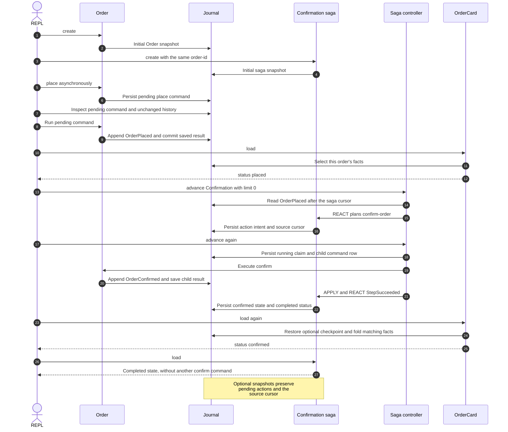

# Simple flow: one aggregate, one projection, one saga

Follow the [line-by-line REPL tutorial](../../docs/tutorials/simple-flow.md)
to place an order, inspect its pending command, let a saga confirm it and
rebuild a projection. All state stays in memory unless you select the supplied
SQLite configuration.

From the repository root, start the REPL:

```sh
cd examples/simple-flow
raku -I../../lib -Ilib
```

Paste the lines of [repl.raku](repl.raku) one at a time. The entity definitions
and two inspection helpers are in [SimpleFlow.rakumod](lib/SimpleFlow.rakumod).
Each executable line is complete; no multiline declarations are needed in the REPL.

To run the same walkthrough as a regular program:

```sh
cd examples/simple-flow
raku -I../../lib -Ilib repl.raku
```

The tutorial also explains how to use [red-sourcing.rakuconf](red-sourcing.rakuconf)
and view this REPL session in the standalone web monitor.

## Sequence: the REPL walkthrough



## Docker stack

From the repository root:

```sh
docker compose -f examples/simple-flow/compose.yaml up --build -d
```

This uses the shared RedSourcing image, an isolated database volume and a
separate monitor at `http://127.0.0.1:3001/monitor`. See the
[Docker guide](../../docs/docker.md) for ports, services and persistent data.
